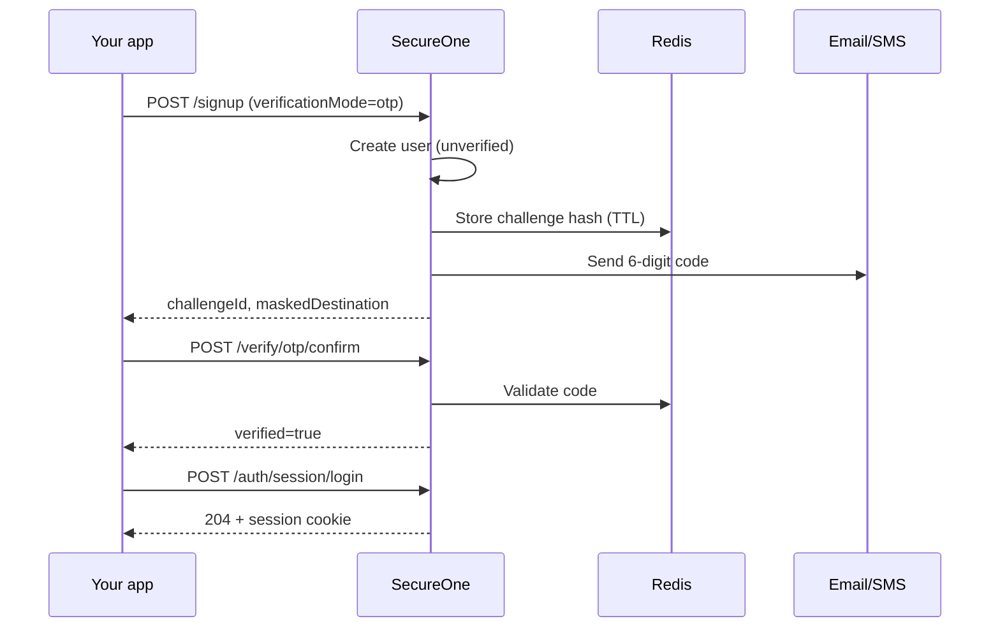
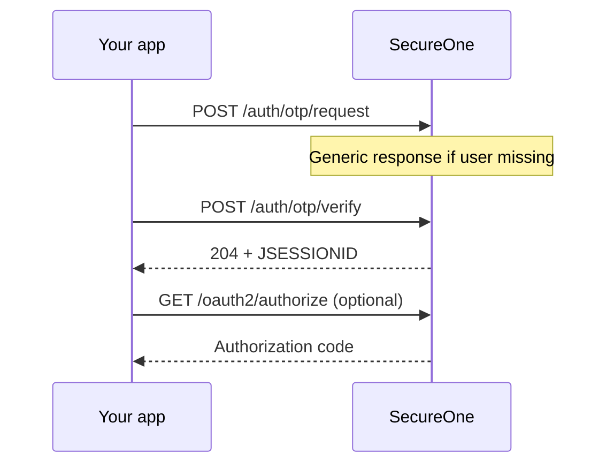

# 19 — Verification, OTP & phone auth

How SecureOne verifies accounts and signs users in using **email links**, **email/phone OTP codes**, **password**, **magic link**, and **OAuth sessions**.

Related: [13 — Auth UI integration](13-auth-ui-integration.md), [05 — Auth standards](05-auth-standards.md), [16 — Environment & operations](16-environment-setup-and-operations.md), [10 — Settings governance](10-settings-governance.md).

---

## What is implemented today

| Capability | Status |
|------------|--------|
| Signup with email + password | Yes |
| Signup verification — **email link** (default) | Yes |
| Signup verification — **email or SMS OTP** | Yes (policy-driven) |
| Optional **phone** on signup (E.164) | Yes |
| Login — email or phone + password | Yes (`identifier` field) |
| Login — **email OTP** (`m_email_otp`) | Yes |
| Login — **SMS OTP** (`m_sms`) | Yes (Twilio or log provider) |
| **Magic link** → session cookie on verify | Yes (HTML + JSON API) |
| **Password reset via link** | Yes |
| **Password reset via OTP** (email/SMS) | Yes (policy + `recovery_otp` flag) |
| **Redis** OTP challenges + session store | Yes |
| Admin **Authentication** settings (Verification & OTP, MFA, Password policy) | Yes |
| TOTP / WebAuthn MFA at login | Not yet (schema + toggles only) |
| User session list / revoke API | Not yet |

---

## Admin configuration

### Platform Settings → Authentication

| Sub-tab | Purpose |
|---------|---------|
| **Sign-in methods** | Password, magic link, federation toggles |
| **Verification & OTP** | Signup, login, and recovery policies; SMS provider |
| **MFA** | Email OTP (`m_email_otp`), SMS OTP (`m_sms`), TOTP/passkey toggles |
| **Password policy** | Length, complexity, expiry, history |

Expose sections to applications under **Platform → For applications** (Verification & OTP, SMS, Password policy, Authentication & MFA).

### Verification policy (signup / login / recovery)

| Setting | Purpose |
|---------|---------|
| **Default mode** | `link` (email URL) or `otp` (numeric code) |
| **OTP length** | 4–8 digits (default 6); clamped server-side |
| **OTP TTL** | Seconds until code expires (default 600) |
| **Max attempts** | Failed tries before lockout (default 5) |
| **Allow user channel choice** | Let clients pick email vs phone OTP |

| Provider | Use |
|----------|-----|
| **log** | Dev default — OTP printed in auth-server logs |
| **twilio** / **aws_sns** / **msg91** | Production SMS |

Configure under **Authentication → Verification & OTP → SMS provider** (platform or per-app).

Enable **SMS OTP** under **Authentication → MFA** (`m_sms`) and **Email OTP** (`m_email_otp`) for login.

### Environment variables

```dotenv
SECUREONE_REDIS_URL=redis://localhost:6379
SECUREONE_OTP_PEPPER=change-me-in-production   # hashes OTP codes at rest
```

Redis is required for OTP hot storage and Spring Session (shared sessions across auth-server instances).

---

## Signup flow

### 1. Check options

```http
GET /api/v1/applications/{applicationId}/signup
```

Response includes `verification` block (signup, login, recovery):

```json
{
  "signupEnabled": true,
  "verification": {
    "signup": {
      "defaultMode": "link",
      "allowedModes": ["link", "otp"],
      "otpLength": 6,
      "otpTtlSeconds": 600
    },
    "login": {
      "identifierTypes": ["email", "phone"],
      "passwordlessModes": ["email_otp", "phone_otp", "magic_link"]
    },
    "recovery": {
      "passwordResetMode": "link",
      "allowedModes": ["link", "otp"],
      "allowedChannels": ["email", "phone"]
    }
  }
}
```

`GET /api/v1/applications/{applicationId}` includes the same `verification` object when the **Verification & OTP** manifest section is enabled.

### 2. Register

```http
POST /api/v1/applications/{applicationId}/signup
Content-Type: application/json

{
  "email": "user@example.com",
  "password": "SecurePass123!",
  "phone": "+14155552671",
  "verificationMode": "otp",
  "verificationChannel": "email"
}
```

| Field | Required | Notes |
|-------|----------|-------|
| `email` | Yes | Normalized to lowercase |
| `password` | Yes | App password policy applies |
| `phone` | No | E.164; unique per tenant |
| `verificationMode` | No | `link` or `otp`; must be in `allowedModes` |
| `verificationChannel` | No | `email` or `phone` / `sms` when mode is `otp` |

**Link mode response** — same as before (`verificationEmailSent`, check MailHog at `http://localhost:8025` in dev).

**OTP mode response:**

```json
{
  "message": "Account created. Enter the verification code sent to your email.",
  "challengeId": "uuid",
  "maskedDestination": "u***@example.com",
  "expiresIn": 600,
  "mode": "otp",
  "channel": "email"
}
```

The code is **never** returned in the API body (only via email/SMS).

### 3. Confirm verification (OTP)

Application-scoped (recommended for integrated apps):

```http
POST /api/v1/applications/{applicationId}/account/verify/otp/confirm
Content-Type: application/json

{
  "challengeId": "uuid-from-signup",
  "code": "123456"
}
```

Global account API (same behavior):

```http
POST /api/v1/account/verify/otp/confirm
Content-Type: application/json

{
  "challengeId": "uuid",
  "code": "123456",
  "channel": "email"
}
```

Use `"channel": "phone"` or `"sms"` when verifying a phone OTP.

### 4. Confirm verification (link — unchanged)

```http
GET /api/v1/account/email/verify?token={rawToken}
```

or

```http
POST /api/v1/account/email/verify
{ "token": "…" }
```

Until verified, password login is blocked (`TenantUserDetailsService` email-verification gate).

---

## Login flows

### Password login (email or phone)

```http
POST /api/v1/applications/{applicationId}/auth/session/login
Content-Type: application/json

{
  "identifier": "user@example.com",
  "password": "SecurePass123!"
}
```

`identifier` accepts **email** or **phone** (E.164 or national format normalized server-side).

Success: `204 No Content` + `JSESSIONID` cookie on auth-server origin.

### Email or SMS OTP login (passwordless)

**1. Request code** (anti-enumeration — always generic success):

```http
POST /api/v1/applications/{applicationId}/auth/otp/request
Content-Type: application/json

{
  "identifier": "user@example.com",
  "channel": "email"
}
```

For phone: `"identifier": "+14155552671", "channel": "sms"`.

Requires `m_email_otp` or `m_sms` enabled for the application.

**2. Verify and create session:**

```http
POST /api/v1/applications/{applicationId}/auth/otp/verify
Content-Type: application/json

{
  "challengeId": "uuid-from-email-or-sms-flow",
  "code": "123456"
}
```

Success: `204` + session cookie. Email/phone marked verified when applicable.

### Magic link (now creates session)

**Request:**

```http
POST /api/v1/applications/{applicationId}/account/magic-link/request
{ "email": "user@example.com" }
```

**Verify (HTML — browser):**

```http
GET /api/v1/account/magic-link/verify?token={rawToken}
```

**Verify (JSON — SPA/native):**

```http
POST /api/v1/account/magic-link/verify
{ "token": "…" }
```

Response:

```json
{
  "signedIn": true,
  "email": "user@example.com",
  "loginUsername": "tenant-slug:user@example.com"
}
```

Also sets `emailVerified=true` and issues `JSESSIONID`.

### Password recovery (link or OTP)

**1. Request reset** (anti-enumeration — generic message always):

```http
POST /api/v1/applications/{applicationId}/account/password/forgot
Content-Type: application/json

{
  "identifier": "user@example.com",
  "mode": "otp",
  "channel": "email"
}
```

Legacy body `{ "email": "user@example.com" }` still works. Requires **Self-service Recovery**; OTP mode also requires **Recovery OTP** feature flag.

**Link mode** — user receives reset URL; complete with `POST /api/v1/account/password/reset` and `{ "token", "password" }`.

**OTP mode response:**

```json
{
  "message": "If an account exists, reset instructions have been sent.",
  "mode": "otp",
  "challengeId": "uuid",
  "maskedDestination": "u***@example.com",
  "expiresIn": 600,
  "channel": "email"
}
```

**2. Set new password with OTP:**

```http
POST /api/v1/applications/{applicationId}/account/password/reset/otp
Content-Type: application/json

{
  "challengeId": "uuid",
  "code": "123456",
  "password": "NewSecurePass1!"
}
```

### OAuth (recommended for SPAs)

After any session-establishing flow above, redirect to `/oauth2/authorize` with PKCE, or start directly from hosted `/login.html`.

---

## End-to-end diagrams

### Signup with OTP



### OTP login



---

## Database & migrations

| Object | Migration | Purpose |
|--------|-----------|---------|
| `otp_challenge` | **V46** | Audit trail for issued/consumed OTPs |
| `platform_setting.verification_policy` | V46+ | Signup/login/recovery policy JSON |
| `platform_setting.sms` | V47+ | SMS provider config |
| `recovery_otp` feature flag | V48 | Password reset via OTP |
| `user_account.phone`, `phone_verified` | V1 (wired in V46) | Phone identity |

Flyway runs on `bootRun`. See [18 — Flyway migration files](18-flyway-migration-files.md).

---

## Security notes

- OTP codes are **hashed** (SHA-256 + server pepper + challenge ID); never stored plaintext.
- **Rate limits**: resend cooldown, max attempts per challenge, Redis-backed counters.
- **Anti-enumeration**: login OTP request and forgot-password always return generic messages.
- **SMS** is last-resort per [05 — Auth standards](05-auth-standards.md); disable by default in production unless policy requires it.
- Set a strong `SECUREONE_OTP_PEPPER` in production (not the dev default).

---

## Local dev checklist

1. `.\scripts\start-all.ps1` — Postgres, Redis, MailHog, auth-server, admin-web.
2. Platform → **Authentication → Verification & OTP** → set modes as needed.
3. Enable `m_email_otp` under **Authentication → MFA**.
4. Sign up via `http://localhost:9000/account/signup.html?applicationId={id}` or API.
5. **Email OTP**: check MailHog `http://localhost:8025`.
6. **SMS OTP**: check auth-server console logs (`LoggingSmsProvider`).
7. Confirm with `POST …/verify/otp/confirm`, then `POST …/auth/session/login`.

---

## Known gaps (next releases)

1. **TOTP / passkey** MFA step-up after password login.
2. **`clientUrls.magicLink`** override for native magic-link landing pages.
3. **`GET /api/v1/account/sessions`** — list and revoke active sessions.

See [08 — Roadmap](08-roadmap.md) for phase planning.
