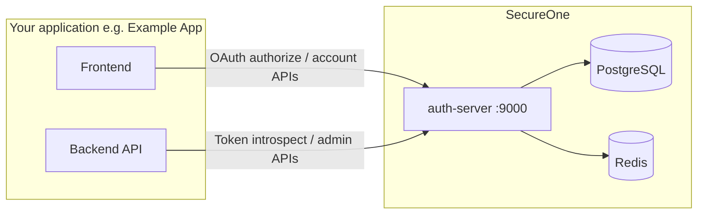

# 22 — Operator getting started

**Audience:** You are new to SecureOne — a platform owner, tenant admin, or DevOps engineer who needs to **install**, **understand**, and **run** the system day to day.

**Not this guide?**

- Building a product frontend (e.g. an online store) and need signup/login APIs → **[23 — Application integration guide](23-application-integration-guide.md)**
- Deploying SecureOne with Docker images + env, or enterprise from source/Helm → **[24 — Deployment: image + env & enterprise](24-deployment-image-env-and-enterprise.md)**

---

## What is SecureOne?

SecureOne is a **central identity platform** (an identity provider you host yourself). Your applications do **not** store passwords or issue their own login tokens. Instead they delegate to SecureOne:

| SecureOne provides | Your apps get |
|--------------------|---------------|
| User accounts per tenant | One login across many products |
| OAuth 2.1 / OpenID Connect | Standard `access_token`, `id_token`, refresh tokens |
| Hosted login pages (optional) | Ready-made signup, login, password reset |
| Admin console | Manage tenants, users, roles, OAuth clients |
| MFA, audit, sessions | Security without rebuilding it in every app |

### Main components

```
┌─────────────────┐     ┌──────────────────┐     ┌─────────────────┐
│   admin-web     │     │   auth-server    │     │  PostgreSQL     │
│   :9000/admin   │────▶│   :9000          │────▶│  + Redis        │
│ Admin console   │     │ OAuth, APIs,     │     │ Users, tokens,  │
│ + Documentation    │     │ hosted login UI  │     │ per-app schemas │
└─────────────────┘     └──────────────────┘     └─────────────────┘
         ▲                        ▲
         │                        │
    You (operator)          End users + your apps
```

| Component | URL (dev) | Who uses it |
|-----------|-----------|-------------|
| **admin-web** | http://localhost:9000/admin | Platform admins, tenant admins, app operators |
| **auth-server** | http://localhost:9000 | End-user login, OAuth, public account APIs |
| **Swagger / OpenAPI** | http://localhost:9000/docs | API exploration |
| **SecureOne Documentation** | http://localhost:9000/admin/documentation | In-app documentation browser |
| **MailHog** (dev email) | http://localhost:8025 | Catches verification/reset emails |

---

## Key concepts (5-minute glossary)

| Term | Meaning |
|------|---------|
| **Tenant** | An organization (e.g. `tenant-a`, `exampleapp`). Users belong to a tenant. |
| **Application (product)** | A product registered in SecureOne (e.g. “Example App Web”, “Billing Portal”). Has its own roles, permissions, and database schema. |
| **OAuth client** | Protocol credentials (`client_id`, redirect URIs) used to obtain tokens. One application can have several clients (web, mobile, M2M). |
| **Platform super-admin** | Runs the whole deployment. Dev login: `admin` / `admin` (no tenant slug). |
| **Tenant admin** | Manages users and apps inside one tenant. Login: `tenantSlug:email`. |
| **End user** | Someone who signs into your product (e.g. a Example App customer). |
| **Hosted UI** | SecureOne’s built-in pages (`login.html`, `signup.html`, …) on auth-server. |
| **Native / custom UI** | Your own frontend calls SecureOne APIs directly. |

More detail: [01 — Overview](01-overview.md), [15 — Applications & OAuth clients](15-applications-and-oauth-clients.md).

---

## First-time setup (local development)

### Prerequisites

| Tool | Version |
|------|---------|
| JDK | 21+ |
| Node.js | 20+ LTS |
| Docker + Compose | Latest |

### Step 1 — Start infrastructure

From the repo root:

```powershell
docker compose -f deploy/docker-compose.yml up -d
```

This starts **PostgreSQL** (`5432`), **Redis** (`6379`), and **MailHog** (SMTP `1025`, UI `8025`).

**Windows shortcut:** `.\scripts\start-all.ps1` also starts auth-server and admin-web. See [16 — Environment & operations](16-environment-setup-and-operations.md).

### Step 2 — Start auth-server

```powershell
cd apps/auth-server
.\gradlew.bat bootRun
```

- Listens on **http://localhost:9000**
- **Flyway** runs database migrations automatically on boot
- Verify: `GET http://localhost:9000/api/info` → `"status":"UP"`

### Step 3 — Start admin-web

```powershell
cd apps/admin-web
npm install
npm run dev
```

Open **http://localhost:9000/admin**. In local development you can sign in with the emergency account **`admin` / `admin`** (Emergency access). On a new installation without any platform operator, the sign-in page links to **first-run setup** (`/admin/setup`): enter the setup code from the auth-server log and create your named operator account; see [24 — First-run setup](24-deployment-image-env-and-enterprise.md#1-first-run-setup-create-the-first-operator).

### Step 4 — Environment variables (reference)

| Variable | Default (dev) | Purpose |
|----------|---------------|---------|
| `SECUREONE_DB_URL` | `jdbc:postgresql://localhost:5432/secureone?currentSchema=platform` | Database |
| `SECUREONE_REDIS_URL` | `redis://localhost:6379` | Sessions, OTP, rate limits |
| `SECUREONE_ISSUER_URL` | `http://localhost:9000` | OIDC issuer in tokens |
| `SECUREONE_PUBLIC_BASE_URL` | `http://localhost:9000` | Links in emails |
| `SECUREONE_DEV_USER` / `_PASSWORD` | `admin` / `admin` | Platform admin API auth |

Full list: [09 — Installation](09-installation.md), [16 — Environment & operations](16-environment-setup-and-operations.md).

---

## Your first hour as operator

Follow this sequence once after install. It mirrors a real onboarding.

### 1. Create a tenant

1. Admin → **Tenants** → **+ Add tenant**
2. Name: `Example App` (example), slug: `exampleapp`
3. Note the **tenant slug** — users sign in as `exampleapp:user@example.com` when using hosted login

### 2. Register an application + OAuth client

1. Admin → **Applications** → **+ Register application & OAuth client**
2. **Application:** tenant = Example App, name = `Example App Web`, slug = `exampleapp-web`
3. **OAuth client:** type = SPA or Web, client ID = `exampleapp-web`, redirect URI = `http://localhost:5173/callback`, PKCE enabled
4. **Copy** the application UUID and client secret (if confidential)

SecureOne provisions a dedicated PostgreSQL schema (`exampleapp_web`) and seeds default roles.

### 3. Create a test user

1. **Tenants** → open Example App → **+ Add user**
2. Email: `customer@example.com`, status Active
3. **Grant access** → assign a role (e.g. Tenant User or app-scoped role)
4. **Applications** → Example App Web console → **Users** → set password

### 4. Configure the application

Open **Application console → Settings** for Example App Web:

| Tab | What to configure |
|-----|-------------------|
| **Integration** | Hosted vs native UI, redirect URIs checklist, API reference |
| **Authentication** | Password, magic link, email/SMS OTP |
| **Verification & OTP** | Signup link vs OTP, recovery mode |
| **Notifications** | SMTP (use MailHog in dev: host `localhost`, port `1025`) |
| **Feature flags** | Enable **Self Registration** if users can sign up |
| **Public manifest** | Enable so frontends can call `GET /api/v1/applications/{id}` |

### 5. Smoke-test login

| Test | How |
|------|-----|
| Hosted login | Open `http://localhost:9000/login.html?applicationId={your-app-uuid}` |
| Admin as tenant user | Sign out → login with `exampleapp:customer@example.com` |
| OAuth PKCE | **Connect an app** → **Test sign-in** |
| Email | Trigger password reset → check http://localhost:8025 |

---

## How SecureOne works (operator view)

### Request flow (simplified)



1. **End user** hits your app → redirected to SecureOne (hosted) or your UI calls SecureOne APIs (native).
2. **auth-server** validates credentials, creates session (Redis) or issues JWT tokens.
3. **Your backend** validates `access_token` (JWT signature via JWKS) or calls `/oauth2/introspect`.
4. **Roles/permissions** are embedded in the token at issuance time from the application schema.

### Who can do what

| Role | Can manage |
|------|------------|
| **Platform super-admin** | All tenants, all applications, OAuth registry, platform settings |
| **Tenant super-admin** | Users, roles, apps within their tenant |
| **Application operator** | Users, RBAC, settings for one application (via Application console) |
| **End user** | Own account security (`/account/security.html`, privacy portal) |

Detail: [11 — Admin control](11-admin-control.md), [14 — Application RBAC](14-application-rbac-management.md).

### Database layout

- **`platform` schema** — tenants, application registry, OAuth clients, global identity
- **`{app_slug}` schema** — per-application roles, permissions, settings, audit (e.g. `exampleapp_web`)

Detail: [06 — Database strategy](06-database.md), [17 — Schemas & tables](17-database-schemas-and-tables.md).

---

## Day-to-day operations

### Admin console map

| Area | URL | Purpose |
|------|-----|---------|
| Applications registry | `/applications` | Register products + OAuth clients (super-admin) |
| Application console | `/app/{applicationId}/…` | Users, roles, settings for one product |
| Tenants | `/tenants` | Organizations, roster, access |
| Platform settings | `/settings` | Global auth policy, SMTP defaults, feature exposure |
| SecureOne Documentation | `/documentation` | Documentation (opens in new tab) |

### Common tasks

| Task | Where |
|------|-------|
| Add a user | Tenant detail → Add user → Grant access → App console → set password |
| Reset user MFA | Application console → Users → MFA → Reset factors |
| Rotate OAuth secret | Applications → OAuth client → Rotate secret |
| Enable self-signup | App settings → Feature flags → Self Registration |
| Configure SMTP | App settings → Notifications |
| View audit | Application console → Audit / Platform audit |
| Impersonate user (support) | Application console → Users → Impersonate (time-boxed) |
| Hosted or native sign-in for an app | App settings → Integration → Authentication UI (published in the manifest as `authUiMode`) |
| Company SSO (SAML) | App settings → Authentication → Add provider → SAML 2.0 → give the IdP the SP values shown ([23](23-application-integration-guide.md#enterprise-sso-saml-20)) |
| Sign-in on TVs / CLIs | Applications → OAuth client → Grant types → `device_code` ([23](23-application-integration-guide.md#device-sign-in-tvs-consoles-clis--rfc-8628)) |
| Rotate signing keys | [Key rotation runbook](runbooks/key-rotation.md) |

### Email in development

All outbound mail goes to **MailHog** when SMTP points to `localhost:1025`. Open http://localhost:8025 to read verification links, OTP codes (if using log provider, check auth-server console instead), and password resets.

### Health checks

| Check | Command / URL |
|-------|---------------|
| Auth-server up | `GET http://localhost:9000/api/info` |
| OIDC discovery | `GET http://localhost:9000/.well-known/openid-configuration` |
| Database migrations | Restart auth-server; check logs for Flyway success |
| Integration probes | App console → Settings → Integration → Run health checks |

### Troubleshooting

| Problem | Likely fix |
|---------|------------|
| Cannot sign in as tenant admin | Use `tenantSlug:email` format on login form |
| Public manifest 404 | Enable public manifest + public API exposure in platform/app settings |
| Emails not arriving | Check MailHog; verify app SMTP settings |
| OAuth redirect mismatch | Add exact callback URL to OAuth client redirect URIs |
| Session lost between requests | Ensure Redis is running; check `SECUREONE_REDIS_URL` |
| Fresh database | `.\scripts\reset-database.ps1` (dev only) |

---

## Production deployment (summary)

For local dev, Docker Compose + `bootRun` / `npm run dev` is enough.

For **image+env deploy** or **enterprise source/Helm deploy** (including admin credentials at deploy time and registering clients after go-live), see:

**[24 — Deployment: image + env & enterprise](24-deployment-image-env-and-enterprise.md)**

Production hardening also includes:

1. **TLS** on auth-server and admin-web
2. **Managed PostgreSQL + Redis** (not single-node dev containers)
3. **Secrets** via vault/KMS — never commit `.env` with production passwords
4. **Helm chart** — `deploy/helm/secureone/` for Kubernetes
5. **Runbooks** — backup, key rotation, incident response in `docs/runbooks/`

Detail: [07 — Security](07-security.md), [runbooks/deploy.md](runbooks/deploy.md).

---

## What to read next

| Goal | Document |
|------|----------|
| Image+env deploy or enterprise from source | **[24 — Deployment: image + env & enterprise](24-deployment-image-env-and-enterprise.md)** |
| Wire your own frontend | **[23 — Application integration guide](23-application-integration-guide.md)** |
| Hosted vs custom login UI | [13 — Auth UI integration](13-auth-ui-integration.md) |
| Signup, OTP, phone auth | [19 — Verification & OTP](19-verification-and-otp.md) |
| OAuth clients & schemas | [15 — Applications & OAuth clients](15-applications-and-oauth-clients.md) |
| All API endpoints | [12 — API documentation](12-api-documentation.md) + http://localhost:9000/docs |
| Settings inheritance | [10 — Settings governance](10-settings-governance.md) |

---

## Quick reference card

```
Install:     docker compose -f deploy/docker-compose.yml up -d
             cd apps/auth-server && .\gradlew.bat bootRun
             cd apps/admin-web && npm run dev

Admin UI:    http://localhost:9000/admin  (admin / admin)
Auth server: http://localhost:9000
API docs:    http://localhost:9000/docs
Docs UI:     http://localhost:9000/admin/documentation
Mail (dev):  http://localhost:8025

Tenant login format:  {tenantSlug}:{email}
Platform admin:       admin / admin (no slug)
```
