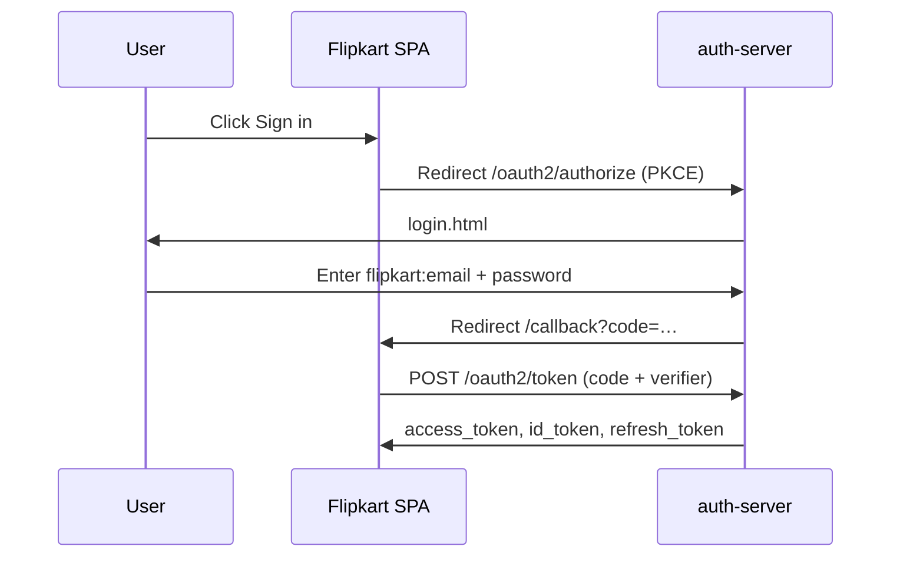
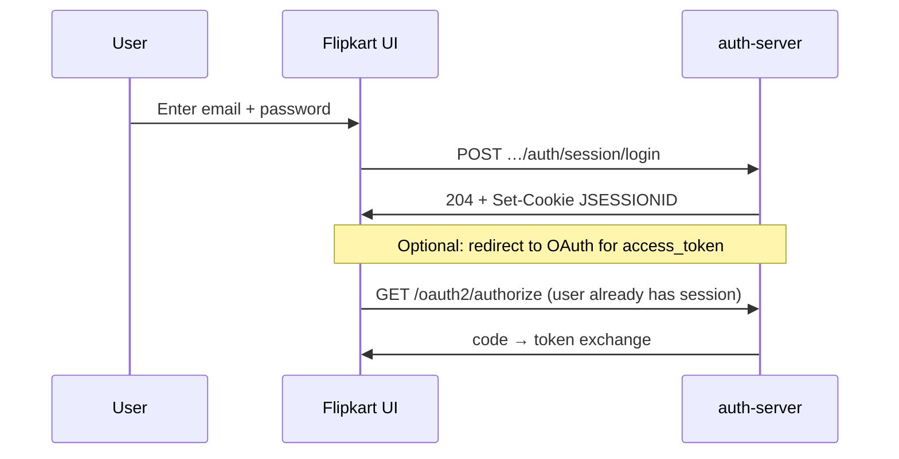

# 23 — Application integration guide

**Audience:** You are a **developer** building a product (e.g. a new Flipkart frontend) and want SecureOne to handle **signup**, **sign-in**, **password reset**, and **tokens**.

**Prerequisite:** A platform operator has registered your application and OAuth client. If not, see **[22 — Operator getting started](22-operator-getting-started.md)** § “Your first hour”.

---

## Example: Flipkart web app

Throughout this guide we use a fictional **Flipkart Web** app:

| Item | Example value |
|------|---------------|
| Tenant slug | `flipkart` |
| Application name | Flipkart Web |
| Application ID | `aaaaaaaa-bbbb-cccc-dddd-eeeeeeeeeeee` (UUID from admin) |
| OAuth client ID | `flipkart-web` |
| Frontend dev URL | `http://localhost:5173` |
| OAuth callback | `http://localhost:5173/callback` |
| Auth-server (issuer) | `http://localhost:9000` |

Replace these with your real values from **Admin → Applications → your app → Settings → Integration**.

---

## Two ways to integrate login UI

SecureOne supports two integration modes. You choose **one per application** (configured in admin, implemented in your frontend).

| Mode | Who renders login/signup? | Best for |
|------|---------------------------|----------|
| **Hosted** (`authUiMode: hosted`) | SecureOne pages on auth-server | Fastest integration, standard OIDC |
| **Native** (`authUiMode: native`) | Your Flipkart UI | Full branding, custom UX |

### How to tell SecureOne which mode you use

**This is configuration, not a per-request API flag.** Set it once in the admin console:

1. **Application console → Settings → Integration → Authentication UI**
2. Choose **Hosted SecureOne UI** or **Native / custom UI**
3. Save

Equivalent admin API (requires operator session or admin credentials):

```http
PUT /api/admin/v1/applications/{applicationId}/client-integration
Content-Type: application/json

{
  "authUiMode": "native",
  "clientUrls": {
    "forgotPassword": "https://www.flipkart.com/account/forgot",
    "passwordReset": "https://www.flipkart.com/account/reset",
    "magicLink": ""
  },
  "checklist": { ... },
  "notes": "Flipkart branded auth"
}
```

| Field | Values | Effect |
|-------|--------|--------|
| `authUiMode` | `"hosted"` or `"native"` | Documents team intent; **your frontend must implement it** |
| `clientUrls.forgotPassword` | Your page URL | Shown in integration docs; your UI calls forgot-password API |
| `clientUrls.passwordReset` | Your page URL | Reset **emails** link here with `?token=…&applicationId=…` appended |
| `clientUrls.magicLink` | Reserved | Magic-link emails still use hosted page today |

**Your frontend discovers endpoints** from the public manifest (no admin auth):

```http
GET /api/v1/applications/{applicationId}
```

The `account` block lists every API path and hosted page URL. When `clientUrls` are configured, they appear under `account.clientUrls`.

> **Important:** SecureOne does not automatically switch UI when an end user visits your site. **You** either redirect to OAuth/hosted pages (`hosted`) or call account APIs from your React/Vue app (`native`). The `authUiMode` setting keeps your team aligned and drives the admin integration checklist.

---

## Step 0 — Collect your identifiers

| Value | Where to find it |
|-------|------------------|
| **Application ID** (UUID) | Admin → Applications → Integration settings header |
| **OAuth client ID** | Same page, or OAuth client detail |
| **Client secret** | Shown once at registration (confidential web apps only; SPAs use PKCE, no secret) |
| **Tenant slug** | Admin → Tenants |
| **Issuer URL** | `http://localhost:9000` or `SECUREONE_ISSUER_URL` |

---

## Step 1 — Enable public discovery

Your frontend needs the manifest. An operator must:

1. **Platform settings** → expose **Public manifest** to applications
2. **Application settings** → **Public manifest** → enabled
3. **Feature flags** → enable **Self Registration** if you offer signup

Test:

```http
GET http://localhost:9000/api/v1/applications/{applicationId}
```

Example response (trimmed):

```json
{
  "applicationId": "aaaaaaaa-bbbb-cccc-dddd-eeeeeeeeeeee",
  "manifestEnabled": true,
  "application": {
    "id": "aaaaaaaa-bbbb-cccc-dddd-eeeeeeeeeeee",
    "name": "Flipkart Web",
    "slug": "flipkart-web",
    "status": "active"
  },
  "authMethods": [
    { "key": "m_password", "enabled": true, "implemented": true },
    { "key": "m_email_otp", "enabled": true, "implemented": true }
  ],
  "featureFlags": [
    { "key": "self_registration", "enabled": true }
  ],
  "verification": {
    "signup": { "defaultMode": "link", "allowedModes": ["link", "otp"] },
    "login": { "identifierTypes": ["email", "phone"], "passwordlessModes": ["email_otp", "magic_link"] }
  },
  "signup": {
    "enabled": true,
    "endpoint": "/api/v1/applications/aaaaaaaa-…/signup"
  },
  "account": {
    "sessionLoginEndpoint": "/api/v1/applications/aaaaaaaa-…/auth/session/login",
    "otpLoginRequestEndpoint": "/api/v1/applications/aaaaaaaa-…/auth/otp/request",
    "otpLoginVerifyEndpoint": "/api/v1/applications/aaaaaaaa-…/auth/otp/verify",
    "forgotPasswordEndpoint": "/api/v1/applications/aaaaaaaa-…/account/password/forgot",
    "verifyOtpConfirmEndpoint": "/api/v1/applications/aaaaaaaa-…/account/verify/otp/confirm",
    "hostedLoginPage": "/login.html?applicationId=aaaaaaaa-…",
    "hostedSignupPage": "/account/signup.html?applicationId=aaaaaaaa-…",
    "clientUrls": {
      "forgotPassword": "https://www.flipkart.com/account/forgot",
      "passwordReset": "https://www.flipkart.com/account/reset"
    }
  }
}
```

**Call this once at app startup** (or cache with TTL). Use the returned paths — do not hardcode URLs in production.

OIDC discovery (issuer-level):

```http
GET http://localhost:9000/.well-known/openid-configuration
```

---

## Step 2 — Choose your integration path

### Path A — Hosted UI (recommended to start)

Your Flipkart app never renders a password field. Users are redirected to SecureOne.



**Authorize URL** (build in your SPA):

```
GET http://localhost:9000/oauth2/authorize
  ?response_type=code
  &client_id=flipkart-web
  &redirect_uri=http://localhost:5173/callback
  &scope=openid profile email
  &state={random}
  &code_challenge={BASE64URL_SHA256_verifier}
  &code_challenge_method=S256
```

**Token exchange** (after callback):

```http
POST http://localhost:9000/oauth2/token
Content-Type: application/x-www-form-urlencoded

grant_type=authorization_code
&code={authorization_code}
&redirect_uri=http://localhost:5173/callback
&client_id=flipkart-web
&code_verifier={original_verifier}
```

**User identifier at hosted login:** `flipkart:user@example.com` (tenant slug + email).

Hosted pages (can link directly):

| Page | URL |
|------|-----|
| Login | `/login.html?applicationId={applicationId}` |
| Signup | `/account/signup.html?applicationId={applicationId}` |
| Forgot password | `/account/forgot-password.html?applicationId={applicationId}` |

Working sample: [samples/external-test-client](../../samples/external-test-client/README.md).

---

### Path B — Native / custom UI (Flipkart-branded)

Your React app renders Flipkart-styled forms and calls SecureOne **public APIs**. No redirect to `login.html`.



#### Sign in with password

```http
POST /api/v1/applications/{applicationId}/auth/session/login
Content-Type: application/json

{
  "identifier": "user@example.com",
  "password": "SecurePass123!"
}
```

- `identifier` = email or phone (E.164, e.g. `+919876543210`)
- Success: `204 No Content` + `Set-Cookie: JSESSIONID=…` (session in Redis)
- Tenant is resolved from the application — you do **not** send tenant slug in the body

For **API access tokens**, still use OAuth after session login (user won’t see login again):

```
GET /oauth2/authorize?...  (same PKCE flow; session cookie sent automatically if same-site)
```

Or use the TypeScript SDK: `packages/secureone-client`.

#### Sign in with email/SMS OTP

```http
POST /api/v1/applications/{applicationId}/auth/otp/request
{ "identifier": "user@example.com", "channel": "email" }

POST /api/v1/applications/{applicationId}/auth/otp/verify
{ "challengeId": "uuid-from-request", "code": "123456" }
```

Requires `m_email_otp` or `m_sms` enabled in auth methods.

---

## Step 3 — Signup (self-registration)

### Check if signup is enabled

```http
GET /api/v1/applications/{applicationId}/signup
```

### Register a new user

```http
POST /api/v1/applications/{applicationId}/signup
Content-Type: application/json

{
  "email": "newuser@example.com",
  "password": "SecurePass123!",
  "phone": "+919876543210",
  "verificationMode": "otp",
  "verificationChannel": "email"
}
```

| Field | Required | Notes |
|-------|----------|-------|
| `email` | Yes | |
| `password` | Yes | Must meet `passwordPolicy` from manifest |
| `phone` | No | E.164 format |
| `verificationMode` | No | `link` (email URL) or `otp` |
| `verificationChannel` | No | `email` or `phone` when mode is `otp` |

**Link verification:** user clicks email link (MailHog in dev).

**OTP verification:**

```http
POST /api/v1/applications/{applicationId}/account/verify/otp/confirm
{ "challengeId": "…", "code": "123456" }
```

Full detail: [19 — Verification & OTP](19-verification-and-otp.md).

---

## Step 4 — Password reset

### Request reset (from your Flipkart “Forgot password” page)

```http
POST /api/v1/applications/{applicationId}/account/password/forgot
Content-Type: application/json

{ "email": "user@example.com" }
```

Always returns a generic success message (anti-enumeration).

### Complete reset

- **Link mode:** email contains a link. If `clientUrls.passwordReset` is set, it points to your Flipkart page with `?token=…&applicationId=…`.
- **OTP mode:** `POST …/account/password/reset/otp` with challenge + new password.

```http
POST /api/v1/account/password/reset
{ "token": "…", "password": "NewSecurePass123!" }
```

---

## Public API reference (no admin auth)

All paths are relative to auth-server (`http://localhost:9000`). CORS allows `localhost` origins with credentials for session cookies.

### Discovery & manifest

| Method | Path | Purpose |
|--------|------|---------|
| GET | `/api/v1/applications/{id}` | Full public manifest |
| GET | `/api/v1/applications/resolve?clientId=flipkart-web` | Resolve app from OAuth client ID |
| GET | `/.well-known/openid-configuration` | OIDC discovery |

### Signup & account

| Method | Path | Purpose |
|--------|------|---------|
| GET | `/api/v1/applications/{id}/signup` | Signup options + verification policy |
| POST | `/api/v1/applications/{id}/signup` | Create account |
| POST | `/api/v1/applications/{id}/account/verify/otp/confirm` | Confirm signup OTP |
| POST | `/api/v1/applications/{id}/account/password/forgot` | Request password reset |
| POST | `/api/v1/applications/{id}/account/password/reset/otp` | Reset with OTP |
| POST | `/api/v1/applications/{id}/account/magic-link/request` | Send magic link |
| POST | `/api/v1/account/magic-link/verify` | Verify magic link (JSON or HTML) |
| POST | `/api/v1/account/password/reset` | Complete reset with token |
| POST | `/api/v1/account/set-password` | Set password from invite |

### Authentication

| Method | Path | Purpose |
|--------|------|---------|
| POST | `/api/v1/applications/{id}/auth/session/login` | Password login → session cookie |
| POST | `/api/v1/applications/{id}/auth/otp/request` | Request login OTP |
| POST | `/api/v1/applications/{id}/auth/otp/verify` | Verify login OTP → session |

### OAuth / OIDC (tokens)

| Method | Path | Purpose |
|--------|------|---------|
| GET | `/oauth2/authorize` | Start authorization code + PKCE |
| POST | `/oauth2/token` | Exchange code, refresh, client credentials |
| GET | `/oauth2/jwks` | Validate JWT signatures |
| GET | `/userinfo` | User claims (Bearer access_token) |
| POST | `/oauth2/introspect` | Validate opaque tokens |
| POST | `/oauth2/revoke` | Revoke tokens |

Interactive reference: **Admin → Settings → Integration → API reference** (filtered to your app) and http://localhost:9000/docs.

---

## Frontend implementation checklist

Use this when building your Flipkart SPA:

- [ ] Store `applicationId`, `clientId`, `issuer` in env config
- [ ] On boot: `GET /api/v1/applications/{id}` → cache manifest
- [ ] Implement `authUiMode` branch:
  - **hosted** → “Sign in” redirects to `/oauth2/authorize` with PKCE
  - **native** → render forms; call session/OTP/signup APIs from manifest `account.*`
- [ ] Register OAuth redirect URI in admin (exact match)
- [ ] Handle callback route `/callback` → exchange code for tokens
- [ ] Store tokens securely (httpOnly cookie via your BFF, or memory + refresh)
- [ ] Validate JWT via JWKS or call `/userinfo`
- [ ] Use `account.clientUrls` for forgot/reset links in native mode
- [ ] Send `credentials: 'include'` if using session cookies cross-origin (configure CORS)
- [ ] Run integration health check in admin console

---

## Code examples

### Fetch manifest (JavaScript)

```javascript
const APPLICATION_ID = "aaaaaaaa-bbbb-cccc-dddd-eeeeeeeeeeee";
const ISSUER = "http://localhost:9000";

const manifest = await fetch(`${ISSUER}/api/v1/applications/${APPLICATION_ID}`)
  .then((r) => r.json());

const { account, signup, authMethods } = manifest;
const useHostedUi = true; // match admin authUiMode: hosted | native

export function signIn() {
  if (useHostedUi) {
    window.location.href = buildAuthorizeUrl();
  } else {
    // show your Flipkart login form; on submit:
    // fetch(account.sessionLoginEndpoint, { method: "POST", credentials: "include", ... })
  }
}
```

### PKCE authorize URL (JavaScript)

```javascript
import { createPkcePair } from "@secureone/client"; // or implement locally

async function buildAuthorizeUrl() {
  const { verifier, challenge } = await createPkcePair();
  sessionStorage.setItem("pkce_verifier", verifier);
  const params = new URLSearchParams({
    response_type: "code",
    client_id: "flipkart-web",
    redirect_uri: "http://localhost:5173/callback",
    scope: "openid profile email",
    state: crypto.randomUUID(),
    code_challenge: challenge,
    code_challenge_method: "S256",
  });
  return `http://localhost:9000/oauth2/authorize?${params}`;
}
```

---

## CORS and cookies (native mode)

- Public APIs allow `http://localhost:*` with `allowCredentials: true`
- Session cookie (`JSESSIONID`) requires your frontend to send `credentials: 'include'`
- For production SPAs on a different domain, prefer **OAuth PKCE** (tokens, no session cookie) or place a **BFF** (backend-for-frontend) on the same origin as the auth-server
- Detail: [13 — Auth UI integration](13-auth-ui-integration.md)

---

## TypeScript SDK

Package: `packages/secureone-client`

```typescript
import { SecureOneClient } from "@secureone/client";

const client = new SecureOneClient({
  issuer: "http://localhost:9000",
  applicationId: "aaaaaaaa-bbbb-cccc-dddd-eeeeeeeeeeee",
});

const manifest = await client.getManifest();
await client.sessionLogin({ identifier: "user@example.com", password: "…" });
```

---

## Testing

```powershell
# From repo root (auth-server on :9000)
.\scripts\test-external-client.ps1
```

Sample SPA: [samples/external-test-client](../../samples/external-test-client/README.md)

---

## Related documents

| Topic | Document |
|-------|----------|
| Operator setup | [22 — Operator getting started](22-operator-getting-started.md) |
| Hosted vs native detail | [13 — Auth UI integration](13-auth-ui-integration.md) |
| OTP, phone, verification | [19 — Verification & OTP](19-verification-and-otp.md) |
| Register app + OAuth client | [15 — Applications & OAuth clients](15-applications-and-oauth-clients.md) |
| OpenAPI / Swagger | [12 — API documentation](12-api-documentation.md) |
