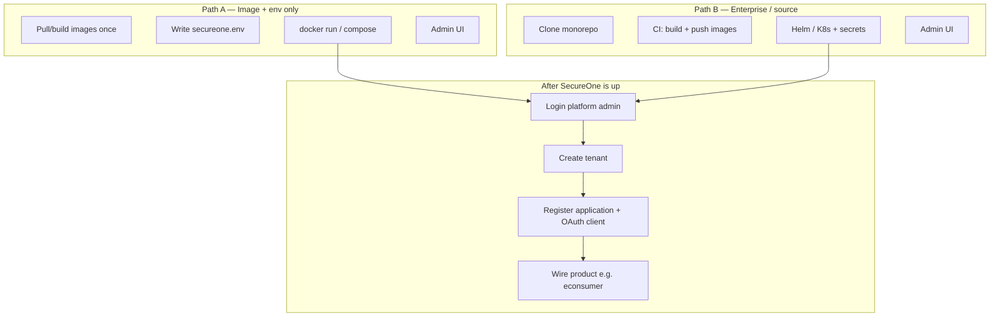

# 24 — Deployment: image + env & enterprise (source)

**Audience:** Platform owners, DevOps, and architects who need to **deploy SecureOne as a central IdP** and then **register applications** (e.g. `econsumer`) from the admin console.

**Related:** [22 — Operator getting started](22-operator-getting-started.md) · [16 — Environment & operations](16-environment-setup-and-operations.md) · [runbooks/deploy.md](runbooks/deploy.md) · [15 — Applications & OAuth clients](15-applications-and-oauth-clients.md) · [23 — Application integration](23-application-integration-guide.md)

---

## Which path should I use?

| Path | When to use | Do you need the SecureOne source tree on the server? | Code change required? |
|------|-------------|------------------------------------------------------|------------------------|
| **Path A — Image + env only** | You already have Docker images; you assign Postgres/Redis/SMTP; you configure everything with env and admin UI | **No** (images + env only) | **No** |
| **Path B — Source / enterprise deploy** | Your team owns the SecureOne monorepo; CI builds images; Helm/K8s for the whole enterprise | **Yes** (build from git) | **No** for normal deploy |

Both paths end the same way: **admin login → create tenants / applications / OAuth clients → connect your products**.



---

## Example product used in this guide

| Item | Example value |
|------|----------------|
| Product / app name | `econsumer` |
| Public app URL | `https://econsumer.com` |
| SecureOne issuer | `https://auth.econsumer.com` |
| Admin console | `https://admin.econsumer.com` |
| OAuth client ID | `econsumer-web` |
| Redirect URI | `https://econsumer.com/callback` |
| Platform admin (deploy-time) | `econsumer-admin` / strong password |

Subdomains under the **same domain** (`econsumer.com`) keep cookies, CORS, and TLS simple.

---

## Target runtime (both paths)

You provide (or compose) these services. SecureOne does **not** embed production Postgres/Redis.

| Component | Role | Typical port |
|-----------|------|--------------|
| **PostgreSQL 16+** | System of record (`platform` + per-app schemas) | `5432` |
| **Redis 7+** | Sessions, OTP, rate limits, MFA | `6379` |
| **SMTP** | Verification, reset, invites | `587` / `465` |
| **auth-server** | OAuth/OIDC, APIs, Flyway | `9000` |
| **admin-web** | Operator console | `3001` |

On first start, **Flyway** applies `platform` migrations automatically. You do not run SQL by hand for schema bootstrap.

---

# Path A — Images + env only (no source on server)

Use this when SecureOne is delivered as **Docker images**: configure with env, start containers, manage applications and OAuth clients in the admin UI.

### What you need

- Pre-built images: `secureone/auth-server`, `secureone/admin-web` (from your registry)
- Your Postgres, Redis, SMTP
- DNS + TLS for `auth.` / `admin.` (or a reverse proxy)
- An env file — **no SecureOne Java/TS code on the host**

### A1 — Prepare Postgres

```bash
psql -h pg.econsumer.com -U postgres -c "CREATE USER secureone WITH PASSWORD 'StrongDbPass!';"
psql -h pg.econsumer.com -U postgres -c "CREATE DATABASE secureone OWNER secureone;"
```

### A2 — Generate secrets

```bash
openssl rand -hex 32          # → SECUREONE_OTP_PEPPER
openssl rand -base64 32       # → SECUREONE_ENCRYPTION_KEY=base64:<value>
```

### A3 — Create `/opt/secureone/secureone.env`

```bash
mkdir -p /opt/secureone
cat > /opt/secureone/secureone.env <<'EOF'
# Profile / environment
# Use staging (or development) for first image+env installs so platform
# admin can be set via SECUREONE_DEV_USER / SECUREONE_DEV_PASSWORD.
SPRING_PROFILES_ACTIVE=dev
SECUREONE_ENV=staging
SECUREONE_SWAGGER_ENABLED=true
SECUREONE_DEV_AUTH_ENABLED=true

# Platform admin credentials (set at deploy time)
SECUREONE_DEV_USER=econsumer-admin
SECUREONE_DEV_PASSWORD=ChangeThisStrongPassword!

# Public URLs
SECUREONE_ISSUER_URL=https://auth.econsumer.com
SECUREONE_PUBLIC_BASE_URL=https://auth.econsumer.com
SECUREONE_ADMIN_WEB_URL=https://admin.econsumer.com
SECUREONE_CORS_ALLOWED_ORIGINS=https://econsumer.com,https://admin.econsumer.com

# Your Postgres
SECUREONE_DB_URL=jdbc:postgresql://pg.econsumer.com:5432/secureone?currentSchema=platform
SECUREONE_DB_USERNAME=secureone
SECUREONE_DB_PASSWORD=StrongDbPass!

# Your Redis
SECUREONE_REDIS_URL=redis://redis.econsumer.com:6379

# Secrets
SECUREONE_OTP_PEPPER=replace-with-long-random-string
SECUREONE_ENCRYPTION_KEY=base64:replace-with-32-byte-key

# Your SMTP
SECUREONE_SMTP_HOST=email-smtp.example.com
SECUREONE_SMTP_PORT=587
SECUREONE_SMTP_USERNAME=smtp-user
SECUREONE_SMTP_PASSWORD=smtp-secret
SECUREONE_SMTP_AUTH=true
SECUREONE_SMTP_STARTTLS=true
SECUREONE_MAIL_LOG_WHEN_UNAVAILABLE=false

SECUREONE_PORT=9000
EOF
chmod 600 /opt/secureone/secureone.env
```

### A4 — Run auth-server

```bash
docker run -d \
  --name secureone-auth \
  --env-file /opt/secureone/secureone.env \
  -p 9000:9000 \
  --restart unless-stopped \
  your-registry/secureone/auth-server:1.0

docker logs -f secureone-auth
# Wait for Flyway + Started AuthServerApplication
```

### A5 — Run admin-web

```bash
docker run -d \
  --name secureone-admin \
  -e NEXT_PUBLIC_AUTH_SERVER_URL=https://auth.econsumer.com \
  -e NEXT_PUBLIC_SECUREONE_ENV=staging \
  -e AUTH_SERVER_URL=http://host.docker.internal:9000 \
  -p 3001:3001 \
  --restart unless-stopped \
  your-registry/secureone/admin-web:1.0
```

On Linux, prefer a shared Docker network and set `AUTH_SERVER_URL=http://secureone-auth:9000`.

### A6 — Optional Compose (apps only; DB/Redis external)

```yaml
# /opt/secureone/docker-compose.yml
services:
  auth-server:
    image: your-registry/secureone/auth-server:1.0
    env_file: ./secureone.env
    ports:
      - "9000:9000"
    restart: unless-stopped

  admin-web:
    image: your-registry/secureone/admin-web:1.0
    environment:
      NEXT_PUBLIC_AUTH_SERVER_URL: https://auth.econsumer.com
      NEXT_PUBLIC_SECUREONE_ENV: staging
      AUTH_SERVER_URL: http://auth-server:9000
    ports:
      - "3001:3001"
    depends_on:
      - auth-server
    restart: unless-stopped
```

```bash
cd /opt/secureone
docker compose up -d
docker compose logs -f auth-server
```

### A7 — TLS / reverse proxy

Point `auth.econsumer.com` → `:9000` and `admin.econsumer.com` → `:3001` (Nginx, Traefik, or cloud LB). Use HTTPS.

### A8 — Health checks

```bash
curl -s https://auth.econsumer.com/api/info
curl -s https://auth.econsumer.com/.well-known/openid-configuration
curl -s https://auth.econsumer.com/actuator/health
```

Expected: auth-server `"status":"UP"`.

### A9 — Continue at [Shared post-deploy flow](#shared-post-deploy-flow)

---

# Path B — Enterprise: you have the code and deploy for the whole organization

Use this when your team **owns the SecureOne monorepo**, builds images in CI, and runs SecureOne as shared enterprise IAM for many products (econsumer, billing, mobile, M2M, …).

### B1 — Clone and prerequisites

```bash
git clone <secureone-repo-url> secureone
cd secureone
```

| Tool | Version |
|------|---------|
| JDK | 21+ (25 tested) |
| Node.js | 20+ LTS |
| Docker | Latest |
| kubectl / Helm | For K8s deploy |

Local infra only (optional for laptop):

```bash
docker compose -f deploy/docker-compose.yml up -d
# Postgres :5432, Redis :6379, MailHog :8025
```

### B2 — Local “source” run (developer / first smoke)

```powershell
# Windows one-command
.\scripts\start-all.ps1
```

Or manually:

```bash
cd apps/auth-server && ./gradlew bootRun
# other terminal
cd apps/admin-web && npm install && npm run dev
```

- Auth: http://localhost:9000  
- Admin: http://localhost:3001  
- Dev platform admin: `admin` / `admin` (when `SECUREONE_DEV_AUTH_ENABLED=true`)

### B3 — Build production images from source

From repo root:

```bash
docker build -f deploy/Dockerfile.auth-server \
  -t your-registry/secureone/auth-server:1.0 \
  apps/auth-server

docker build -f deploy/Dockerfile.admin-web \
  -t your-registry/secureone/admin-web:1.0 \
  .

docker push your-registry/secureone/auth-server:1.0
docker push your-registry/secureone/admin-web:1.0
```

CI should tag with git SHA / semver and scan images.

### B4 — Create Kubernetes secret

```bash
kubectl create namespace secureone

kubectl -n secureone create secret generic secureone-auth-server \
  --from-literal=SECUREONE_DB_URL='jdbc:postgresql://pg.internal:5432/secureone?currentSchema=platform' \
  --from-literal=SECUREONE_DB_USERNAME='secureone' \
  --from-literal=SECUREONE_DB_PASSWORD='StrongDbPass!' \
  --from-literal=SECUREONE_REDIS_URL='redis://redis.internal:6379' \
  --from-literal=SECUREONE_OTP_PEPPER="$(openssl rand -hex 32)" \
  --from-literal=SECUREONE_ENCRYPTION_KEY="base64:$(openssl rand -base64 32)" \
  --from-literal=SECUREONE_ISSUER_URL='https://auth.econsumer.com' \
  --from-literal=SECUREONE_PUBLIC_BASE_URL='https://auth.econsumer.com' \
  --from-literal=SECUREONE_ADMIN_WEB_URL='https://admin.econsumer.com' \
  --from-literal=SECUREONE_CORS_ALLOWED_ORIGINS='https://econsumer.com,https://admin.econsumer.com' \
  --from-literal=SECUREONE_DEV_USER='econsumer-admin' \
  --from-literal=SECUREONE_DEV_PASSWORD='ChangeThisStrongPassword!' \
  --from-literal=SECUREONE_DEV_AUTH_ENABLED='true' \
  --from-literal=SECUREONE_ENV='staging' \
  --from-literal=SPRING_PROFILES_ACTIVE='dev' \
  --from-literal=SECUREONE_SMTP_HOST='email-smtp.example.com' \
  --from-literal=SECUREONE_SMTP_PORT='587' \
  --from-literal=SECUREONE_SMTP_USERNAME='smtp-user' \
  --from-literal=SECUREONE_SMTP_PASSWORD='smtp-secret' \
  --from-literal=SECUREONE_SMTP_AUTH='true' \
  --from-literal=SECUREONE_SMTP_STARTTLS='true'
```

Adjust `SECUREONE_ENV` / profile when you harden to full production (see [Production caveats](#production-caveats)).

### B5 — Helm install

Create `prod-values.yaml` (example):

```yaml
authServer:
  replicaCount: 2
  image:
    repository: your-registry/secureone/auth-server
    tag: "1.0"
  existingSecret: secureone-auth-server
  env:
    SPRING_PROFILES_ACTIVE: "dev"
    SECUREONE_ENV: "staging"
    SECUREONE_SWAGGER_ENABLED: "true"
    SECUREONE_DEV_AUTH_ENABLED: "true"

adminWeb:
  replicaCount: 2
  image:
    repository: your-registry/secureone/admin-web
    tag: "1.0"
  env:
    NEXT_PUBLIC_SECUREONE_ENV: staging
    NEXT_PUBLIC_AUTH_SERVER_URL: https://auth.econsumer.com

postgres:
  enabled: false
  url: jdbc:postgresql://pg.internal:5432/secureone?currentSchema=platform

redis:
  enabled: false
  url: redis://redis.internal:6379

ingress:
  enabled: true
  className: nginx
  host: auth.econsumer.com
  tlsSecretName: secureone-tls
```

```bash
helm upgrade --install secureone deploy/helm/secureone \
  -n secureone \
  -f prod-values.yaml

kubectl -n secureone rollout status deployment/secureone-auth-server
curl -s https://auth.econsumer.com/actuator/health
```

Also expose **admin-web** (second host or path) → `https://admin.econsumer.com`.

### B6 — Enterprise operating model

| Practice | Recommendation |
|----------|----------------|
| One SecureOne cluster | Shared IdP for all products |
| One tenant per customer org (B2B) **or** one product tenant (B2C) | Match your business |
| One **application** per product | e.g. `econsumer`, `billing`, `partner-portal` |
| N **OAuth clients** per application | web, SPA, mobile, M2M |
| Secrets | Vault / cloud secrets → K8s secret; never commit `.env` |
| Replicas | auth-server ≥ 2; sessions/OTP in Redis |
| Backups | Postgres + Redis RPO/RTO defined |
| Observability | `/actuator/health`, Prometheus scrape (restrict network) |

### B7 — Continue at [Shared post-deploy flow](#shared-post-deploy-flow)

---

# Shared post-deploy flow

Once auth-server and admin-web are healthy (Path A or B), operators use the **same** admin workflow.

## 1. Login to admin

1. Open `https://admin.econsumer.com/login`
2. Username: value of `SECUREONE_DEV_USER` (e.g. `econsumer-admin`)
3. Password: value of `SECUREONE_DEV_PASSWORD`
4. Leave tenant blank (platform super-admin)

## 2. Platform settings

In **Settings**:

| Area | Action |
|------|--------|
| **Notifications / SMTP** | Confirm mail delivery |
| **Authentication methods** | Enable password, email OTP, etc. |
| **Feature flags** | Enable **Self registration** if end users may sign up |
| **Password policy** | Align with org policy |

## 3. Create tenant (if needed)

**Tenants → Create**

| Field | Example |
|-------|---------|
| Name | Econsumer |
| Slug | `econsumer` |

## 4. Register application + OAuth client

**Applications → Register application & OAuth client**

| Field | Example |
|-------|---------|
| Application name | `econsumer` |
| Tenant | `econsumer` |
| Slug | `econsumer` (schema `econsumer`) |
| Client ID | `econsumer-web` |
| Type | SPA (PKCE) or Web |
| Redirect URIs | `https://econsumer.com/callback` |
| Scopes | `openid profile email` |
| Auth UI mode | `hosted` or `native` |

Save and copy:

- **Application ID** (UUID)
- **Client ID**
- Client secret (confidential clients only — shown once)

## 5. Wire the product (econsumer)

In the **econsumer** app config only (not SecureOne source):

```env
SECUREONE_ISSUER=https://auth.econsumer.com
SECUREONE_APPLICATION_ID=<uuid-from-admin>
SECUREONE_CLIENT_ID=econsumer-web
SECUREONE_REDIRECT_URI=https://econsumer.com/callback
```

### Hosted UI (redirect to SecureOne login)

```
GET https://auth.econsumer.com/oauth2/authorize
  ?response_type=code
  &client_id=econsumer-web
  &redirect_uri=https://econsumer.com/callback
  &scope=openid%20profile%20email
  &code_challenge=...
  &code_challenge_method=S256
  &state=...
```

Then `POST https://auth.econsumer.com/oauth2/token` and optionally `GET /userinfo`.

### Native UI (forms on econsumer.com)

```http
POST https://auth.econsumer.com/api/v1/applications/{applicationId}/auth/session/login
Content-Type: application/json

{ "identifier": "user@example.com", "password": "..." }
```

Signup / OTP: see [23 — Application integration](23-application-integration-guide.md) and [19 — Verification & OTP](19-verification-and-otp.md).

## 6. Features available after deploy

| Feature | Where |
|---------|--------|
| Tenants & applications | Admin console |
| OAuth clients (web/SPA/native/M2M) | Admin → Applications |
| Users, invites, roster | Application / tenant console |
| Roles, permissions, groups | Application RBAC |
| Hosted login / signup / reset | auth-server static pages |
| Native session login & signup APIs | Public application APIs |
| MFA policy | Platform / app settings |
| Sessions revoke | Admin |
| Audit / application logs | Admin |
| Service accounts / API keys | Admin |
| OIDC discovery, JWKS, tokens | `/.well-known/openid-configuration` |
| Self-service signup | Feature flag + APIs |

---

## Production caveats

| Topic | Current behavior | Guidance |
|-------|------------------|----------|
| Platform admin via env | Works with `SECUREONE_DEV_USER` / `SECUREONE_DEV_PASSWORD` when `SECUREONE_DEV_AUTH_ENABLED=true` | Use for Path A / first enterprise staging |
| `SECUREONE_ENV=production` | **Rejects** `SECUREONE_DEV_AUTH_ENABLED=true` and default OTP pepper | Do **not** switch to full production until bootstrap-admin is implemented **or** you have another platform-admin path |
| `SECUREONE_BOOTSTRAP_ADMIN_EMAIL/PASSWORD` | Documented in `.env.example` | **Not implemented in code yet** — do not rely on these alone |
| Recommended first real deploy | `SECUREONE_ENV=staging` + strong custom admin credentials | Then harden SMTP, TLS, replicas, backups |

**Code change required?**  

- Path A / Path B as documented above: **No**.  
- True production profile + first-boot admin from env only: **Yes** (future bootstrap work).

---

## Day-2 commands

```bash
# Logs
docker logs -f secureone-auth
# or
kubectl -n secureone logs -f deploy/secureone-auth-server

# Restart after env change
docker rm -f secureone-auth
docker run -d --name secureone-auth --env-file /opt/secureone/secureone.env \
  -p 9000:9000 your-registry/secureone/auth-server:1.0

# Upgrade image
docker pull your-registry/secureone/auth-server:1.1
# recreate container / helm upgrade --set authServer.image.tag=1.1

# Health
curl -s https://auth.econsumer.com/api/info
curl -s https://auth.econsumer.com/actuator/health
```

Flyway runs again on new image start for pending migrations.

---

## Checklist

### Path A (image + env)

- [ ] Postgres / Redis / SMTP reachable  
- [ ] Images pulled  
- [ ] `secureone.env` filled (URLs, secrets, admin user/pass)  
- [ ] auth-server UP  
- [ ] admin-web UP  
- [ ] TLS for auth + admin hosts  

### Path B (enterprise / source)

- [ ] Repo cloned / CI builds images  
- [ ] Managed Postgres + Redis  
- [ ] K8s secret created  
- [ ] Helm release healthy (≥ 2 auth replicas preferred)  
- [ ] Ingress + TLS  

### Shared

- [ ] Platform admin can sign in  
- [ ] Tenant + `econsumer` application + OAuth client created  
- [ ] Product config points at issuer  
- [ ] End-to-end login tested (hosted or native)  

---

## Related documents

| Topic | Document |
|-------|----------|
| First operator walkthrough | [22 — Operator getting started](22-operator-getting-started.md) |
| Env vars, MailHog, schedulers | [16 — Environment & operations](16-environment-setup-and-operations.md) |
| Short deploy notes | [runbooks/deploy.md](runbooks/deploy.md) |
| Apps vs OAuth clients | [15 — Applications & OAuth clients](15-applications-and-oauth-clients.md) |
| App developer APIs | [23 — Application integration](23-application-integration-guide.md) |
| Prod hardening roadmap | [20 — Production completion master plan](20-production-completion-master-plan.md) |
