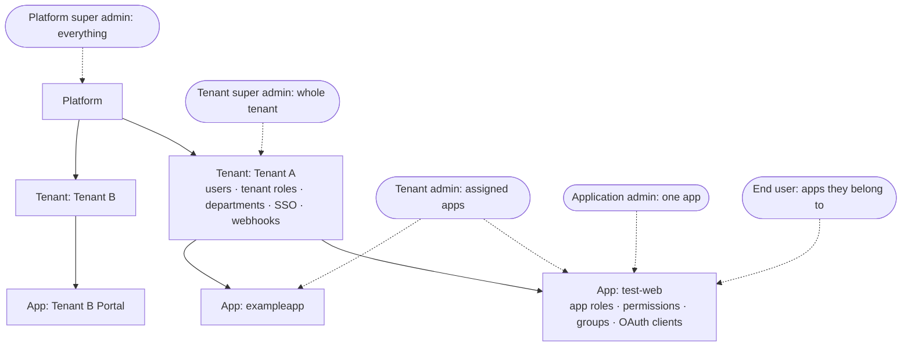
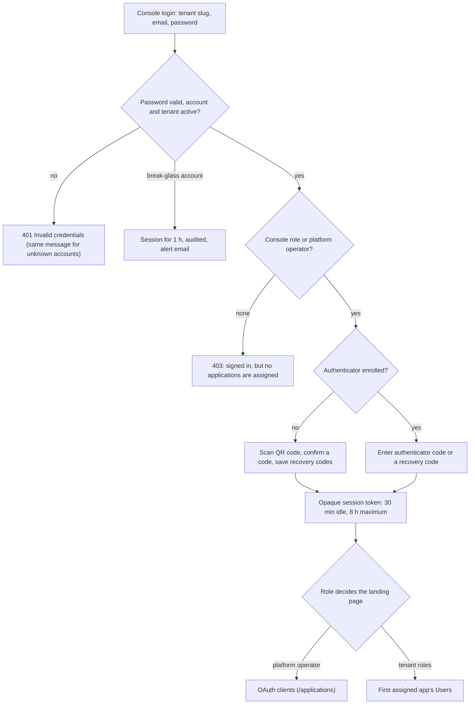
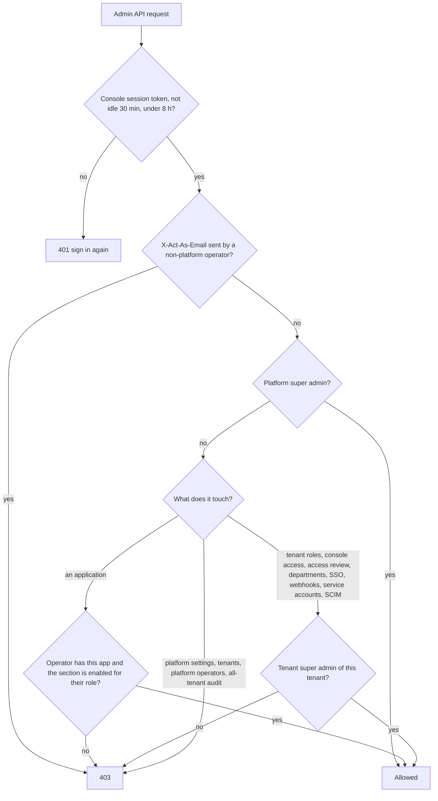
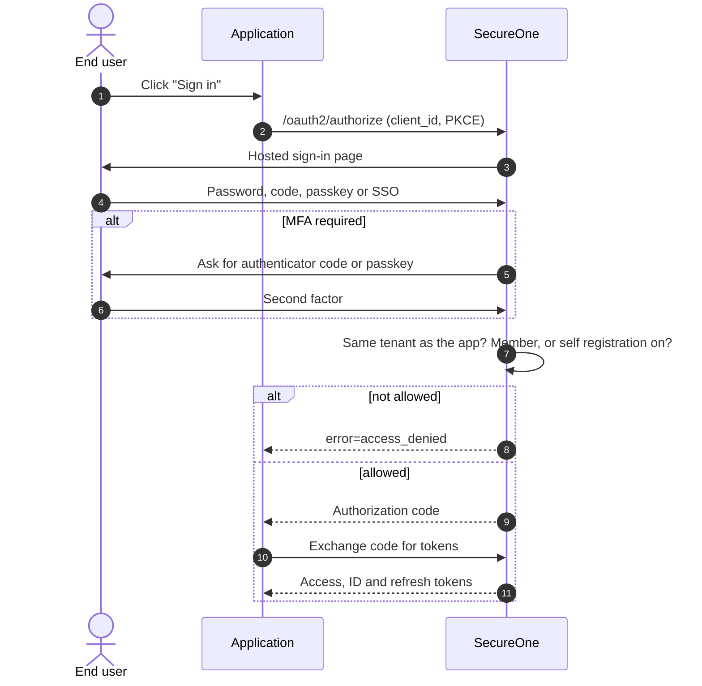

# 25 — Roles and access

Who can sign in where, what each role sees, what each role can do, and how the server enforces it.
This page describes the system as built (October 2026). The last section maps it to common
privileged-access standards.

**Related:** [11 — Admin control](11-admin-control.md) · [14 — Application RBAC](14-application-rbac-management.md) ·
[05 — Auth standards](05-auth-standards.md) · [07 — Security](07-security.md)

---

## Two sign-in doors

| Door | URL (local) | Who | Purpose |
|---|---|---|---|
| **Admin console** | `http://localhost:9000/admin/login` | Platform super admin and anyone with a console role | Manage tenants, applications, users, roles, settings |
| **Hosted sign-in and account pages** | `http://localhost:9000/login.html`, `/account/*` | End users, reached from an application's "Sign in" | Sign in to applications (OAuth 2.1 / OIDC) and manage their own account |

The console sign-in page has two tabs, and every sign-in ends with an authenticator-app code:

| Who | Where on the sign-in page | Enter |
|---|---|---|
| Tenant operators | **Organization** tab | Tenant slug, email, password (the tenant slug is remembered) |
| Platform operators | **Platform operator** tab | Email and password (the reserved tenant `platform` is used for you) |
| Emergency account | **Emergency access** link | Username and password; no MFA, audited, 1-hour session |

After an idle timeout or the maximum session length, the sign-in page says why the session ended.

A **tenant** is an organization, not a role. Each tenant owns its users and applications; each application has
its own roles, permissions and groups. Console roles are granted on top of that structure.

Nobody below the platform super admin can see another tenant.

---

## Console sign-in and landing page

- The password step alone returns a short-lived MFA challenge (5 minutes), never a session.
- Five wrong codes end the challenge, and wrong codes count toward the account lockout like wrong passwords.
- Admin APIs accept only console session tokens. HTTP Basic and hosted sign-in cookies are refused, so MFA cannot be bypassed.

If a person holds several console roles, the highest one decides the view.

---

## Roles

### Platform super admin

- **How you get it:** an existing platform super admin adds you under **Access review → Platform operators**. You get an account in the reserved `platform` tenant and an email to set your password; you set up an authenticator app at first sign-in.
- **Break-glass account:** the account configured at install (`SECUREONE_DEV_USER` / `SECUREONE_DEV_PASSWORD`; `admin` / `admin` in local dev). In production it works only while `SECUREONE_BREAK_GLASS_ENABLED=true`, its password must be a bcrypt hash, sessions last 1 hour, and every sign-in is audited and emailed to platform admins. Use it to recover when no named operator can sign in.
- **Sidebar:** Application console (every app) · OAuth clients · Platform settings · Access review · SecureOne Documentation · Tenant → Tenants, Roles & Permissions.
- **Can:** create, edit, suspend and delete tenants (not the reserved `platform` tenant); create applications and OAuth clients, rotate secrets; change platform settings, feature flags, MFA, password and token policy; add and remove platform operators (not themselves); grant or revoke any console role; run the platform-wide access review; see audit, logs and sessions across all tenants; delete users; everything a tenant super admin can do, in any tenant.

### Tenant super admin (`TENANT_SUPER_ADMIN`)

- **How you get it:** granted by the platform super admin for one tenant.
- **Sidebar:** Application console (all apps in the tenant) · Documentation · Tenant → Tenants, Roles & Permissions, Access review (own tenant only).
- **Can:** every section of every app in the tenant; tenant roles & permissions and their assignment; choose which console sections each console role sees; grant and revoke application admin and tenant admin in their tenant; run the tenant's access review; departments, SSO providers, service accounts and API keys, webhooks, access requests, SCIM token; the tenant roster; **Connect an app** and the OAuth clients of every application in the tenant (register, edit, rotate secrets, delete).
- **Cannot:** see other tenants, change platform settings, create tenants or applications, grant or revoke tenant super admin, delete users.

### Tenant admin (`TENANT_ADMIN`)

- **How you get it:** granted per application by the platform super admin or the tenant super admin.
- **Sidebar:** Application console (assigned apps; switch in the header) · Documentation.
- **Default sections:** Users · Roles · Groups · Permissions · Settings · Audit log · Application logs · Sessions, in each assigned app.
- **Also:** **Connect an app** (sidebar) for the assigned apps: register OAuth clients and manage them (edit, rotate secrets, delete). The wizard offers only those apps and cannot create a new application.
- **Cannot:** open the tenant page, tenant roles or tenant-level features; touch apps they are not assigned to (the server refuses their clients, too); create applications.

### Application admin (`APPLICATION_ADMIN`)

- **How you get it:** granted for exactly one application by the platform super admin or the tenant super admin.
- **Sidebar:** that application's sections only.
- **Default sections:** Users · Roles · Groups · Settings · Audit log · Sessions. The tenant super admin can add or remove sections; the server enforces the same list, including filtered views such as `/api/admin/v1/logs?applicationId=…`.
- **No second permission layer:** the console role and its enabled sections are the grant. Operators no longer also need an app role with `user:read`, `role:read` and so on.
- **Cannot:** see other apps, tenant pages, platform-wide audit, logs or sessions; register or change OAuth clients (it can view its app's clients); grant itself higher roles. Someone who is tenant admin of one app and application admin of another manages clients only in the first.

### End user (no console role)

- **How you get one:** self sign-up (when the app allows it), an admin invite, SSO just-in-time creation, or SCIM provisioning.
- **Can:** sign in with password, email or SMS code, magic link, passkey, or Google, GitHub or company SSO; set up an authenticator app, recovery codes and passkeys; reset a forgotten password; see and end their sessions; export their data or request deletion.
- **Cannot:** open the admin console; sign in to an app they are not a member of, unless that app allows self registration.

---

### Your own security settings

Open **My profile** from your name in the top bar:

- **Account and password:** named operators edit their display name and change their password (platform operators follow the platform password policy). The emergency account has nothing to edit here.
- **Multi-factor authentication:** shows whether your authenticator is set up and how many recovery codes are left (fewer than 4 is highlighted). **Generate new recovery codes** replaces the whole set; old codes stop working. Removing your authenticator means you set up a new one at your next sign-in. Passkeys can be added too.
- **Session banners:** a red banner stays visible while you use the emergency account, and an amber warning appears 10 minutes before your session's maximum length is reached.

## Capability matrix

"Own" = limited to the operator's tenant or assigned apps. App-section rows show defaults; a tenant super admin can change them per role.

| Capability | Platform super admin | Tenant super admin | Tenant admin | Application admin | End user |
|---|---|---|---|---|---|
| Platform settings, feature flags, policies | Yes | No | No | No | No |
| Create tenants and applications | Yes | No | No | No | No |
| Connect an app / OAuth clients | All apps; may create applications | Manage, every app of own tenant | Manage, assigned apps | View, own app | No |
| Add platform operators | Yes | No | No | No | No |
| Grant tenant super admin | Yes | No | No | No | No |
| Grant application admin, tenant admin | Any tenant | Own | No | No | No |
| Access review | All tenants | Own | No | No | No |
| Audit, logs, sessions across all tenants | Yes | No | No | No | No |
| Tenant roles & permissions | Any tenant | Own | No | No | No |
| Console role sections | Any tenant | Own | No | No | No |
| Departments, SSO, webhooks, service accounts, access requests, SCIM | Any tenant | Own | No | No | No |
| Suspend tenant (blocks all its sign-ins) | Yes | No | No | No | No |
| Users (invite, verify, reset password, MFA reset) | All apps | All own apps | Assigned apps | One app | No |
| Roles and groups | All apps | All own apps | Assigned apps | One app | No |
| Permissions catalog | All apps | All own apps | Assigned apps | Off by default | No |
| App settings (auth methods, MFA, email, flags) | All apps | All own apps | Assigned apps | One app | No |
| App audit log and sessions | All apps | All own apps | Assigned apps | One app | No |
| Application logs | All apps | All own apps | Assigned apps | Off by default | No |
| Delete users permanently | Yes | No | No | No | No |
| Own password, MFA, passkeys, sessions, privacy | Yes | Yes | Yes | Yes | Yes |

---

## How every console request is checked

The console hides what a role cannot reach, and the server checks again on every call
(`AdminAccessInterceptor`, `AdminAccessService`, controller checks).

- Revoking a console role or a platform operator takes effect on the operator's next request (the session token is re-checked each call).
- Locking or disabling an account ends its open console sessions.
- Suspending a tenant blocks every sign-in for its users, including operators.
- Cross-tenant attempts return 403 or 404 and never reveal data.

---

## How an end user signs in to an application

Refresh tokens rotate on every use; reusing an old one revokes the whole sign-in and writes an audit entry.

---

## Giving someone a role

1. The person needs a user account in the tenant: invite from an app's Users page, self sign-up, SSO or SCIM.
2. Grant a console role on the tenant page under **Admin console access**: the tenant super admin can grant application admin or tenant admin; tenant super admin needs the platform super admin.
3. A tenant super admin can tune which console sections each role sees.
4. They sign in at the console with tenant slug, email and password, and set up an authenticator app the first time.

To add a platform operator: **Access review → Platform operators → Add**. They receive a password-setup email and sign in with tenant slug `platform`.

---

## Standards alignment

Mapped to SOC 2 CC6, ISO 27001 A.5.15–A.8.5 and NIST SP 800-63B AAL2. Every row is covered by the
end-to-end suites (including a dedicated privileged-access suite) and runs with row-level security
enforced.

| Area | How SecureOne meets it |
|---|---|
| **Individual accountability** | Platform super admins are named accounts in the reserved `platform` tenant (the tenant cannot be renamed, suspended or deleted). The configured account is break-glass only: off in production unless `SECUREONE_BREAK_GLASS_ENABLED=true`, bcrypt password required, 1-hour sessions, audited and emailed on every use. |
| **MFA for privileged access (AAL2)** | Every console sign-in except break-glass needs an authenticator-app code or a single-use recovery code. Operators without an authenticator enroll during sign-in. Codes are single-use, five wrong codes end the challenge, and wrong codes count toward account lockout. |
| **No MFA bypass** | Admin APIs accept only console session tokens. HTTP Basic, raw credential headers and hosted sign-in cookies are refused. `X-Act-As-Email` works only for platform super admins. |
| **No account probing** | Unknown account and wrong password return the same "Invalid credentials." |
| **Least privilege and delegation** | Tenant super admins grant and revoke application admin and tenant admin in their own tenant; only platform super admins grant tenant super admin or add platform operators. Nobody can remove their own platform role. |
| **One permission model** | A console role and the sections enabled for it are the whole grant, enforced on every call, including filtered views such as `/logs?applicationId=…`. |
| **Session management** | Console sessions end after 30 minutes idle and 8 hours at most (configurable). Revoking a role, removing a platform operator, or locking or disabling an account takes effect on the next request. When a session ends, the console returns to sign-in. |
| **Tenant isolation in the database** | PostgreSQL row-level security is enforced by default. Request queries run as `secureone_app` (no superuser, no BYPASSRLS; migration V63) and see only the request's tenant. Tenant users are pinned to their own tenant whatever IDs a request names. Sign-in and protocol endpoints, startup jobs and platform super admins use an explicit platform scope. Startup fails if enforcement is on but the database role would bypass it. |
| **Periodic access review** | **Access review** lists everyone with a platform or console role, with scope, who granted it and when, last sign-in, MFA status and flags (no MFA, never signed in, unused 90 days, account not active). Platform super admins review all tenants, tenant super admins their own. Export to CSV; "Mark review complete" writes an audit entry as evidence. |

### Operating notes

- **Production database roles:** Flyway connects as the schema owner (`SECUREONE_DB_MIGRATION_USERNAME`, defaults to `SECUREONE_DB_USERNAME`). The pool switches each connection to `secureone_app`. To avoid holding owner credentials in the app, give it its own login role that is a member of `secureone_app`.
- **Turning RLS off** (`SECUREONE_RLS_ENFORCE=off`) brings back the legacy "unscoped sees everything" fallback. Log lines starting `RLS unscoped` show any code path that would need a scope.
- **Remaining limits:** console MFA uses authenticator apps and recovery codes (operator passkeys can be enrolled but are not yet offered as a console second factor). Rate limits key on the client IP, including `X-Forwarded-For`, so the proxy in front must overwrite that header.
