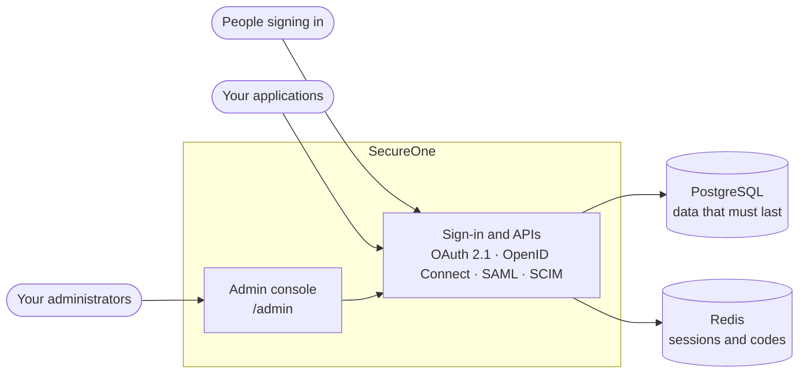
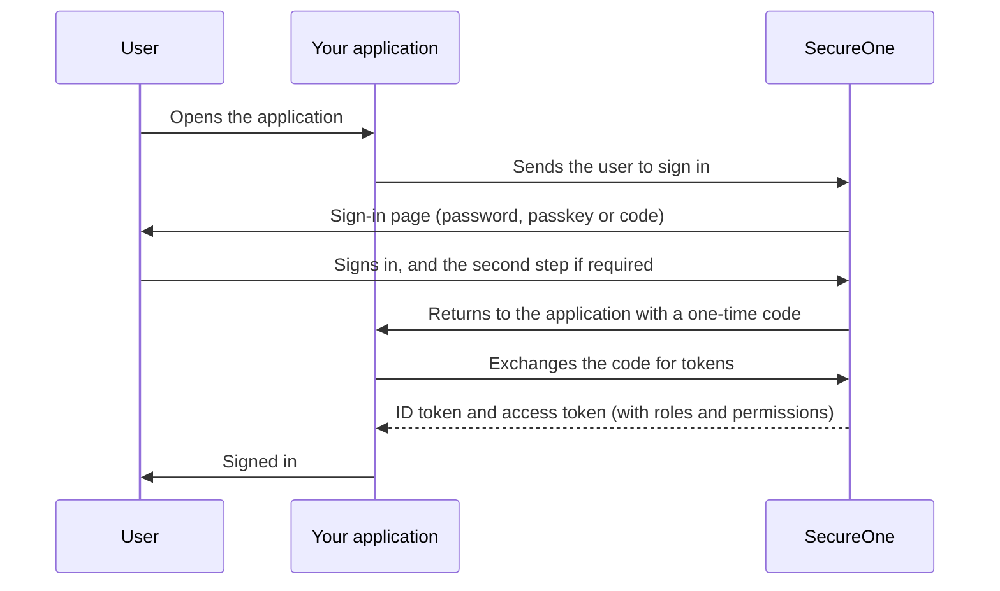
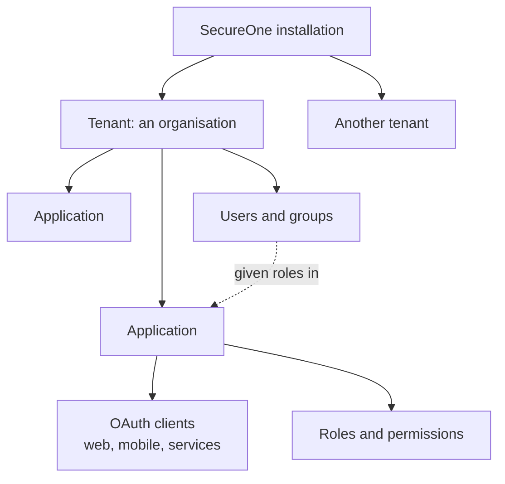
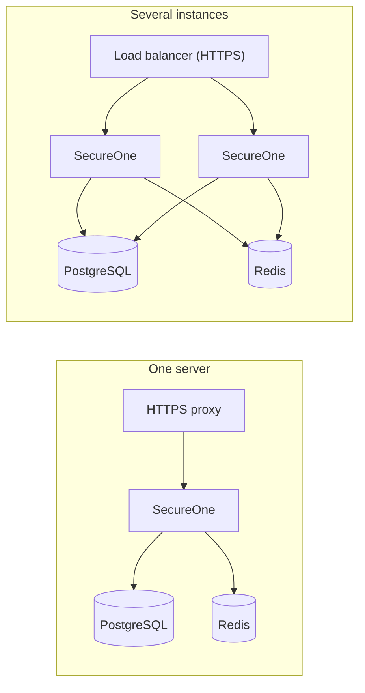

# How SecureOne fits together

SecureOne sits between your users and your applications. Applications send users to SecureOne to sign in (or call
its sign-in APIs), and get back standard tokens that say who the user is and what they may do.

## The parts

| Part | What it does |
|---|---|
| **SecureOne** | One container. Signs people in, issues tokens, serves the sign-in pages and the APIs, and hosts the admin console at `/admin`. |
| **PostgreSQL** | Keeps tenants, users, applications, roles, settings and the audit log. Back it up. |
| **Redis** | Keeps short-lived state: sessions, one-time codes and rate limits. It needs no backup. |

## How a sign-in works

Your application never sees the user's password. It checks the roles and permissions in the access token to decide
what the user may do. See [Hosted and native sign-in](../integrate/hosted-and-native-sign-in.md) for applications
that draw their own sign-in screens.

## How things are organised

Each tenant's users and data are kept apart from every other tenant's. See [Key concepts](../get-started/concepts.md).

## Running it

Start with one server. For more traffic or no downtime during updates, run several SecureOne containers behind a load
balancer: they share PostgreSQL and Redis, so any of them can serve any request. See [Deployment](../install/deployment.md).
