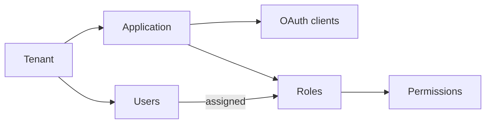

# Key concepts

## The building blocks

| Concept | What it is |
|---|---|
| **Tenant** | An organisation or customer. Its users and data are isolated from every other tenant. |
| **Application** | A product you protect with SecureOne, inside a tenant. It has its own roles, permissions and settings. |
| **OAuth client** | How one front end or service of an application talks to SecureOne: a web app, a single-page app, a mobile app, a back-end service or a device. One application can have several. |
| **User** | A person who signs in. Users belong to a tenant and are given access to applications. |
| **Role** | A named set of permissions inside an application, such as *Viewer* or *Editor*. |
| **Permission** | One thing a user may do, such as `invoice:read`. Your application checks permissions. |
| **Group** | A set of users who get the same roles. |
| **Platform operator** | Someone who runs the SecureOne installation itself and manages every tenant. |
| **Service account** | A non-human identity for machine-to-machine calls, using API keys or client credentials. |

## How sign-in works

1. Your application sends the user to SecureOne (hosted sign-in), or shows its own sign-in screen that calls
   SecureOne's APIs (native sign-in). See [Hosted and native sign-in](../integrate/hosted-and-native-sign-in.md).
2. SecureOne checks the password, passkey or one-time code, and the second step when required.
3. Your application receives standard tokens: an ID token (who the user is) and an access token (what they may
   call), with their roles and permissions.

## Where settings live

Settings are layered: the **platform** sets defaults and limits, a **tenant** can tighten them, and each
**application** can adjust what it is allowed to. See [Settings governance](../install/settings-governance.md).
