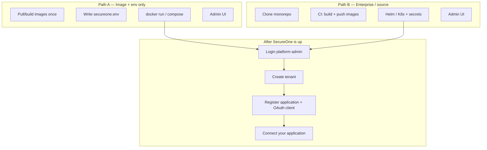

# Deployment

**Audience:** Platform owners, DevOps, and architects who need to **deploy SecureOne as a central IdP** and then **register applications** from the admin console.

**Related:** [Operator getting started](../get-started/operator-getting-started.md) · [Environment & operations](environment-and-operations.md) · [Deploy](runbooks/deploy.md) · [Applications & OAuth clients](../integrate/applications-and-oauth-clients.md) · [Application integration](../integrate/integration-guide.md)

---

SecureOne is installed from its container image, `dmtavs0108/secureone:1.0.0`, with your own PostgreSQL, Redis and secrets. Configure everything with environment variables, then manage tenants, applications and OAuth clients in the admin console.

<!-- developer -->
## Which path should I use?

| Path | When to use | Do you need the SecureOne source tree on the server? | Code change required? |
|------|-------------|------------------------------------------------------|------------------------|
| **Path A — Image + env only** | You already have Docker images; you assign Postgres/Redis/SMTP; you configure everything with env and admin UI | **No** (images + env only) | **No** |
| **Path B — Source / enterprise deploy** | Your team owns the SecureOne monorepo; CI builds images; Helm/K8s for the whole enterprise | **Yes** (build from git) | **No** for normal deploy |

Both paths end the same way: **admin login → create tenants / applications / OAuth clients → connect your products**.

**One image, one port, one host.** SecureOne ships as a single container image, `dmtavs0108/secureone` (current version `1.0.0`). It serves OAuth/OIDC, SAML, SCIM, the hosted sign-in pages and the APIs, and the **admin console at `/admin`** on the same host (the auth-server starts the console itself and forwards `/admin` to it). Every setting is an environment variable read at start-up, so the same image serves every installation.

**Just evaluating?** One command starts SecureOne with PostgreSQL, Redis and a mail catcher on your machine:

```bash
docker compose -f deploy/docker-compose.quickstart.yml up --build
# $SECUREONE_URL/admin  (admin@example.com / Quickstart-Admin-2026!) · email: http://localhost:8025
```

The quickstart runs in development mode with throw-away passwords; never expose it.


<!-- /developer -->

---

## Example values used in this guide

| Item | Example value |
|------|----------------|
| Application name / slug | `Example App` / `exampleapp` |
| Public app URL | `https://app.example.com` |
| SecureOne issuer | `https://id.example.com` |
| Admin console | `https://id.example.com/admin` (same host) |
| OAuth client ID | `exampleapp-web` |
| Redirect URI | `https://app.example.com/callback` |
| First platform operator | `owner@example.com` / strong password (temporary) |

Replace these with your own values. Everything SecureOne serves is on one host (`id.example.com`): one DNS name, one certificate, no CORS between the console and the API.

---

## Target runtime (both paths)

You provide (or compose) these services. SecureOne does **not** embed production Postgres/Redis.

| Component | Role | Typical port |
|-----------|------|--------------|
| **PostgreSQL 16+** | System of record (`platform` + per-app schemas) | `5432` |
| **Redis 7+** | Sessions, OTP, rate limits, MFA | `6379` |
| **SMTP** | Verification, reset, invites | `587` / `465` |
| **SecureOne** (`dmtavs0108/secureone`) | OAuth/OIDC, SAML, SCIM, hosted pages, APIs, Flyway; admin console at `/admin` | `9000` |

On first start, **Flyway** creates the schema from `V1__baseline.sql` on the empty database; later releases upgrade it at start-up. You do not run SQL by hand.

---

# Path A — Images + env only (no source on server)

Use this when SecureOne is delivered as **Docker images**: configure with env, start containers, manage applications and OAuth clients in the admin UI.

### What you need

- The image `dmtavs0108/secureone:1.0.0` (Docker Hub, or your registry)
- Your Postgres, Redis, SMTP
- DNS + TLS for one host, e.g. `id.example.com` (or a reverse proxy)
- An env file — **no SecureOne Java/TS code on the host**

### A1 — Prepare Postgres

```bash
psql -h pg.internal -U postgres -c "CREATE USER secureone WITH PASSWORD 'StrongDbPass!';"
psql -h pg.internal -U postgres -c "CREATE DATABASE secureone OWNER secureone;"
```

### A2 — Generate secrets

```bash
openssl rand -hex 32          # → SECUREONE_OTP_PEPPER
openssl rand -base64 32       # → SECUREONE_ENCRYPTION_KEY=base64:<value>

# OAuth/OIDC token signing key (required when SECUREONE_ENV=production)
openssl genpkey -algorithm RSA -pkeyopt rsa_keygen_bits:2048 -out jwk.pem      # → SECUREONE_JWK_PRIVATE_KEY_PEM

# SAML SP signing/decryption key + certificate (optional; generated once and stored encrypted if unset)
openssl req -x509 -newkey rsa:2048 -nodes -days 3650 -subj "/CN=SecureOne SAML SP" \
  -keyout saml-sp.key -out saml-sp.crt                                          # → SECUREONE_SAML_SP_KEY_PEM / _CERT_PEM
```

| Secret | What it protects | If you lose / change it |
|--------|------------------|--------------------------|
| `SECUREONE_ENCRYPTION_KEY` | AES-256-GCM key for secrets stored in the database (SMTP/SMS credentials, IdP client secrets, and the JWT / SAML private keys when they are not supplied by env). Kept **outside** the database, so a DB copy alone decrypts nothing. Startup fails on a malformed value; a warning is logged when it is missing. | Values written with it can no longer be decrypted: keep it in your secret manager and back it up separately from the database. Values written before you first set it still decrypt (database fallback key) and are re-encrypted when next saved. |
| `SECUREONE_JWK_PRIVATE_KEY_PEM` | Signs access / ID tokens (JWKS `kid` derived from the key) | Rotate with overlap: set the new key here and the old one in `SECUREONE_JWK_PREVIOUS_PRIVATE_KEY_PEM` (published + accepted, never used to sign) — see the [key-rotation runbook](runbooks/key-rotation.md) |
| `SECUREONE_SAML_SP_KEY_PEM` + `SECUREONE_SAML_SP_CERT_PEM` | Signs SAML AuthnRequests / LogoutRequests and decrypts encrypted assertions; the certificate is in the SP metadata | IdPs must re-import the SP metadata (or the new certificate) |
| `SECUREONE_OTP_PEPPER` | Hashes one-time codes | Outstanding codes stop working |

### A3 — Create `/opt/secureone/secureone.env`

```bash
mkdir -p /opt/secureone
cat > /opt/secureone/secureone.env <<'EOF'
# The image runs in production mode (SECUREONE_ENV=production): https URLs and the secrets below are required.

# First platform operator, created at the first start (temporary password: the first sign-in replaces it)
SECUREONE_BOOTSTRAP_ADMIN_EMAIL=owner@example.com
SECUREONE_BOOTSTRAP_ADMIN_PASSWORD=Change-This-Strong-Password-1!

# Public URLs
SECUREONE_ISSUER_URL=https://id.example.com
SECUREONE_PUBLIC_BASE_URL=https://id.example.com
# The console is at <public URL>/admin; set SECUREONE_ADMIN_WEB_URL only if you serve it elsewhere.
# Origins of registered redirect URIs are allowed automatically; list only other browser origins
# that call SecureOne APIs directly (optional):
SECUREONE_CORS_ALLOWED_ORIGINS=

# Your Postgres
SECUREONE_DB_URL=jdbc:postgresql://pg.internal:5432/secureone?currentSchema=platform
SECUREONE_DB_USERNAME=secureone
SECUREONE_DB_PASSWORD=StrongDbPass!

# Your Redis
SECUREONE_REDIS_URL=redis://redis.internal:6379

# Secrets
SECUREONE_OTP_PEPPER=replace-with-long-random-string
SECUREONE_ENCRYPTION_KEY=base64:replace-with-32-byte-key
# PEM values: keep the BEGIN/END lines (use \n for line breaks in a one-line env file)
SECUREONE_JWK_PRIVATE_KEY_PEM=
# Optional (SAML SSO): otherwise generated once and stored encrypted
SECUREONE_SAML_SP_KEY_PEM=
SECUREONE_SAML_SP_CERT_PEM=

# Your SMTP (used from the first start; once SMTP is saved under Platform settings → Notifications, that wins)
SECUREONE_SMTP_HOST=email-smtp.example.com
SECUREONE_SMTP_PORT=587
SECUREONE_SMTP_USERNAME=smtp-user
SECUREONE_SMTP_PASSWORD=smtp-secret
SECUREONE_SMTP_AUTH=true
SECUREONE_SMTP_STARTTLS=true
SECUREONE_MAIL_LOG_WHEN_UNAVAILABLE=false

EOF
chmod 600 /opt/secureone/secureone.env
```

### A4 — Run SecureOne

```bash
docker run -d \
  --name secureone \
  --env-file /opt/secureone/secureone.env \
  -p 9000:9000 \
  --restart unless-stopped \
  dmtavs0108/secureone:1.0.0

docker logs -f secureone
# Wait for "Started AuthServerApplication" and "Admin console started ... served at /admin"
```

One container, one process tree: the auth-server (Java) starts the console (Node.js) on `127.0.0.1` inside the container, restarts it if it exits, and stops it on shutdown. Console output appears in the same log under the `console` logger.

### A5 — Optional Compose (DB/Redis external)

```yaml
# /opt/secureone/docker-compose.yml
services:
  secureone:
    image: dmtavs0108/secureone:1.0.0
    env_file: ./secureone.env
    ports:
      - "9000:9000"
    restart: unless-stopped
```

```bash
cd /opt/secureone
docker compose up -d
docker compose logs -f secureone
```

### A6 — Console settings (optional)

| Variable | Default in the image | Meaning |
|----------|----------------------|---------|
| `SECUREONE_CONSOLE_DIR` | `/opt/secureone/console/apps/admin-web` | Built console the auth-server runs; empty = no console in this container (API-only nodes) |
| `SECUREONE_CONSOLE_PORT` | `3001` | Internal port on `127.0.0.1` (never published) |
| `SECUREONE_CONSOLE_UPSTREAM_URL` | — | Forward `/admin` to a console running elsewhere instead |
| `SECUREONE_ADMIN_WEB_URL` | `<SECUREONE_PUBLIC_BASE_URL>/admin` | Console URL shown in `/api/info` and the docs discovery API |
| `SECUREONE_DOCS_DIR` | `/opt/secureone/docs` | Documentation shown in the console (SecureOne Documentation) |
| `SECUREONE_MANAGEMENT_PORT` | `9001` | Health, info and Prometheus metrics, served **only** on this port (no authentication there). Do not publish it: probes and the metrics scraper reach it inside your network. `/actuator` is not served on 9000 |
| `JAVA_TOOL_OPTIONS` | `-XX:+UseG1GC -XX:MaxRAMPercentage=75 …` | JVM options. Keep `-XX:+UseG1GC`: the start-up cache below is only used with the collector it was recorded with |

<!-- developer -->
**SecureOne logo.** The mark is a set of fixed files, not a setting: Appearance settings, tenant and application
branding never change it (application logos only brand that application's hosted sign-in pages). To use another
mark, replace the files at the same paths, keeping the names:

| File (source tree) | In the image | Used for |
|--------------------|--------------|----------|
| `apps/admin-web/public/brand/secureone-mark.svg` | `/opt/secureone/console/apps/admin-web/public/brand/secureone-mark.svg` | Console sidebar, sign-in and setup pages, console tab icon |
| `apps/admin-web/public/brand/apple-touch-icon.png` (180 px) | same folder | Home-screen icon |
| `apps/admin-web/src/app/favicon.ico` | built into the console | Tab icon for browsers without SVG icons |
| `apps/auth-server/src/main/resources/static/favicon.svg`, `favicon.ico` | inside the auth-server jar | Tab icon of the hosted sign-in and account pages |
| `apps/admin-web/public/brand/secureone-logo.svg` | console `public/brand` | Mark with the name (README, documents) |

Rebuild the image after replacing them. Without rebuilding, the console files can be swapped in a running
installation with a read-only mount, e.g. `-v /opt/secureone/brand:/opt/secureone/console/apps/admin-web/public/brand:ro`
(the folder must contain every file listed for `public/brand`).
<!-- /developer -->

**Start-up cache.** The image carries a JDK 25 ahead-of-time cache (`/opt/secureone/app.aot`), recorded at build time by starting the application once against a throw-away database. The JVM uses it automatically, so a new container or pod is ready noticeably sooner (see the timings in the CI log or `Started AuthServerApplication in … seconds`). If the JVM version or flags no longer match, it starts normally without it; `-e JDK_JAVA_OPTIONS=-XX:AOTMode=off` turns it off for comparison.

### A7 — TLS / reverse proxy

Point `id.example.com` → `:9000` (Nginx, Traefik, or cloud LB). Use HTTPS. The console is the `/admin` path on the same host; no second host, port or route is needed.

- Forward `X-Forwarded-Proto/Host/For` (the auth-server trusts them: `server.forward-headers-strategy: native`) so the issuer, SAML entity IDs, ACS/SLO URLs and the device `verification_uri` come out as `https://id.example.com/…`.
- **Do not add CORS or origin rules in front of** `/api/v1/auth/federation/saml/acs/*` and `/api/v1/auth/federation/saml/slo/*`: the company IdP's page posts there cross-site (any `Origin`, often `null`). The SAML signatures authenticate those requests.
- WAFs: allow form POSTs with large `SAMLResponse` bodies (encrypted assertions can exceed 20 KB).

**Outbound access the auth-server needs:** your SMTP and SMS gateways, the Google/GitHub/OIDC IdPs used for social sign-in, and each SAML IdP's **metadata URL** (fetched when the provider is saved, refreshed every 10 minutes).

### A8 — Health checks

```bash
curl -s https://id.example.com/api/info
curl -s https://id.example.com/.well-known/openid-configuration
curl -s -o /dev/null -w "%{http_code}\n" https://id.example.com/admin/login   # 200
docker exec secureone wget -qO- http://127.0.0.1:9001/actuator/health              # management port, inside the container
docker inspect secureone --format '{{.State.Health.Status}}'                          # healthy (image HEALTHCHECK)
```

Expected: discovery JSON, the console sign-in page at `/admin/login`, and `"status":"UP"` on the management port. `https://id.example.com/actuator/...` returns 404 by design.

### A9 — Continue at [Shared post-deploy flow](#shared-post-deploy-flow)

---

<!-- developer -->
# Path B — Enterprise: you have the code and deploy for the whole organization

Use this when your team **owns the SecureOne monorepo**, builds images in CI, and runs SecureOne as shared enterprise IAM for many products (web, mobile, back-end services, …).

### B1 — Clone and prerequisites

```bash
git clone <secureone-repo-url> secureone
cd secureone
```

| Tool | Version |
|------|---------|
| JDK | 21+ (25 tested) |
| Node.js | 20+ LTS |
| Docker | Latest |
| kubectl / Helm | For K8s deploy |

Local infra only (optional for laptop):

```bash
docker compose -f deploy/docker-compose.yml up -d
# Postgres :5432, Redis :6379, MailHog :8025
```

### B2 — Local “source” run (developer / first smoke)

```powershell
# Windows one-command
.\scripts\start-all.ps1
```

Or manually:

```bash
cd apps/auth-server && ./gradlew bootRun
# other terminal
cd apps/admin-web && npm install && npm run dev
```

- Auth: your SecureOne address
- Admin console: `/admin` (the auth-server forwards it to `next dev`; for hot reload you can also use http://localhost:3001/admin directly)  
- First run: create the operator with the setup code from the auth-server log (`/admin/setup`); in development the emergency account `admin` / `admin` also works

### B3 — Build production images from source

From repo root:

```bash
docker build -f deploy/Dockerfile -t your-registry/secureone:1.0.0 .
docker push your-registry/secureone:1.0.0
```

Give the builder about 4 GB of memory (the console's type check and the Gradle build run in parallel, and the last step starts the application once with a temporary PostgreSQL and Redis to record the start-up cache). With Docker Desktop's 2 GB default, build the console stage first and the rest reuses it: `docker build --target console -f deploy/Dockerfile .` then the command above.

The console installs from the root **`pnpm-lock.yaml`** (`pnpm install --frozen-lockfile`); after changing `apps/admin-web/package.json`, run `pnpm install` so the lockfile matches, or the image build stops.

The build context is the repo root; `.dockerignore` is an allow-list, so local `.env` files, keys and `node_modules` never reach the build. Nothing environment-specific is baked in: no URLs, no environment name, no secrets.

CI builds and smoke-tests the image on every push (`.github/workflows/ci.yml`, job `image`); publish it tagged with a semantic version (and the git SHA), and scan it.

> **Build network:** the build downloads Gradle (services.gradle.org, which redirects to GitHub release downloads), npm and Maven packages. The auth-server build also pulls OpenSAML (SAML SSO) from the Shibboleth Maven repository (`https://build.shibboleth.net/maven/releases/`) as well as Maven Central. Allow it in CI egress or mirror it in your artifact proxy (Nexus/Artifactory); Gradle only resolves the `org.opensaml` / `net.shibboleth` groups from it.

### B4 — Create Kubernetes secret

```bash
kubectl create namespace secureone

kubectl -n secureone create secret generic secureone \
  --from-literal=SECUREONE_DB_URL='jdbc:postgresql://pg.internal:5432/secureone?currentSchema=platform' \
  --from-literal=SECUREONE_DB_USERNAME='secureone' \
  --from-literal=SECUREONE_DB_PASSWORD='StrongDbPass!' \
  --from-literal=SECUREONE_REDIS_URL='redis://redis.internal:6379' \
  --from-literal=SECUREONE_OTP_PEPPER="$(openssl rand -hex 32)" \
  --from-literal=SECUREONE_ENCRYPTION_KEY="base64:$(openssl rand -base64 32)" \
  --from-file=SECUREONE_JWK_PRIVATE_KEY_PEM=jwk.pem \
  --from-file=SECUREONE_SAML_SP_KEY_PEM=saml-sp.key \
  --from-file=SECUREONE_SAML_SP_CERT_PEM=saml-sp.crt \
  --from-literal=SECUREONE_ISSUER_URL='https://id.example.com' \
  --from-literal=SECUREONE_PUBLIC_BASE_URL='https://id.example.com' \
  --from-literal=SECUREONE_BOOTSTRAP_ADMIN_EMAIL='owner@example.com' \
  --from-literal=SECUREONE_BOOTSTRAP_ADMIN_PASSWORD='Change-This-Strong-Password-1!' \
  --from-literal=SECUREONE_SMTP_HOST='email-smtp.example.com' \
  --from-literal=SECUREONE_SMTP_PORT='587' \
  --from-literal=SECUREONE_SMTP_USERNAME='smtp-user' \
  --from-literal=SECUREONE_SMTP_PASSWORD='smtp-secret' \
  --from-literal=SECUREONE_SMTP_AUTH='true' \
  --from-literal=SECUREONE_SMTP_STARTTLS='true'
```

The image runs in production mode; see [All settings](#all-settings) for what else you can set.

**Several replicas** (the chart runs 2): all shared state — sessions, SAML AuthnRequests and logout state, device-code polling, rate limits, the one-time key-creation lock — lives in Redis, so any replica can serve any step of a flow. Supply the JWT and SAML keys from the secret (as above) so every replica uses the same keys from the first boot.

### B5 — Helm install

Create `prod-values.yaml` (example):

```yaml
image:
  repository: dmtavs0108/secureone
  tag: "1.0.0"
replicaCount: 2
existingSecret: secureone
env:
  SECUREONE_ISSUER_URL: https://id.example.com
  SECUREONE_PUBLIC_BASE_URL: https://id.example.com
  SECUREONE_DB_URL: jdbc:postgresql://pg.internal:5432/secureone?currentSchema=platform
  SECUREONE_REDIS_URL: redis://redis.internal:6379

ingress:
  enabled: true
  className: nginx
  host: id.example.com
  tlsSecretName: secureone-tls
```

```bash
helm upgrade --install secureone deploy/helm/secureone \
  -n secureone \
  -f prod-values.yaml

kubectl -n secureone rollout status deployment/secureone
curl -s https://id.example.com/.well-known/openid-configuration
```

The chart runs one Deployment (rolling update with `maxUnavailable: 0`), one Service and an optional Ingress for the single host; the console is the `/admin` path behind it. The pod runs as UID 10001 (`runAsNonRoot`).

### B6 — Enterprise operating model

| Practice | Recommendation |
|----------|----------------|
| One SecureOne cluster | Shared IdP for all products |
| One tenant per customer org (B2B) **or** one product tenant (B2C) | Match your business |
| One **application** per product | e.g. web shop, billing, partner portal |
| N **OAuth clients** per application | web, SPA, mobile, M2M |
| Secrets | Vault / cloud secrets → K8s secret; never commit `.env` |
| Replicas | auth-server ≥ 2; sessions/OTP in Redis |
| Backups | Postgres + Redis RPO/RTO defined |
| Observability | Health and Prometheus on the management port 9001 (pod-internal; the chart's probes and `prometheus.io/port` annotation use it) |

### B7 — Continue at [Shared post-deploy flow](#shared-post-deploy-flow)
<!-- /developer -->

---

# Shared post-deploy flow

Once SecureOne is healthy, operators use the admin workflow below.

## 1. First-run setup: create the first operator

Two ways; pick one.

**A. With the container settings (no browser step).** Set these when you create the container; the first start creates the first platform operator:

| Setting | Example |
|---------|---------|
| `SECUREONE_BOOTSTRAP_ADMIN_EMAIL` | `owner@example.com` |
| `SECUREONE_BOOTSTRAP_ADMIN_PASSWORD` | a strong password (platform password policy); better as a secret file, see below |
| `SECUREONE_BOOTSTRAP_ADMIN_FIRST_NAME`, `..._LAST_NAME` | optional |

- Used **once**: when an operator already exists they are ignored (the log says so), so leaving them in place never creates a second admin. Remove the password after the first start anyway.
- If the values cannot be used (no `@` in the email, password against the policy), the server **does not start** and the log names the setting: an automated install never comes up without the admin it asked for.
- Several instances starting together create the admin once.
- The bootstrap password is temporary: the first sign-in (Platform operator tab) asks for a new password, which is stored only in the database; the environment value is never used again.
- Console MFA follows `SECUREONE_ENV`: required in production (the first sign-in then also sets up an authenticator app), off in development. `SECUREONE_ADMIN_MFA_REQUIRED` overrides it. API docs (Swagger) likewise: off in production, on in development; `SECUREONE_SWAGGER_ENABLED` overrides it.

**B. In the browser with a setup code.** On a new installation without A, the server says so in its log:

```
==============================================================================
 SecureOne is not set up yet: no platform operator exists.
 Open https://id.example.com/admin/setup and enter this setup code:  9NNC-DZ3H-WF6S
 (valid for 24 hours; every instance prints it again when it starts)
==============================================================================
```

1. Open `https://id.example.com/admin/setup` (the sign-in page also links there while setup is open).
2. Enter the setup code. It proves you can read the server's log; 10 wrong codes from one address lock it for 15 minutes.
3. Create the first platform operator: name, work email, password (platform password policy).
4. Sign in under **Platform operator**. In production the first sign-in also adds an authenticator app and shows recovery codes once.

After that, setup is closed for good (`/admin/setup` redirects to sign-in; the API answers `410 Gone`). Add more operators from **Access review → Platform operators**. For automated installs, set `SECUREONE_SETUP_CODE` instead of reading the log.

The emergency account (`SECUREONE_DEV_USER` / `SECUREONE_DEV_PASSWORD` with `SECUREONE_BREAK_GLASS_ENABLED=true`) is only for regaining access when no named operator can sign in; production does not need it.

### All settings

The image starts in **production mode** (`SECUREONE_ENV=production` inside the image). Each setting can be an environment variable or a file of the same name in `/run/secrets` (see below). If a required one is missing or unusable, the container stops at start-up and the log names it.

**Always required**

| Setting | Example / how to create |
|---------|-------------------------|
| `SECUREONE_DB_URL` | `jdbc:postgresql://db:5432/secureone?currentSchema=platform` (keep `currentSchema=platform`) |
| `SECUREONE_DB_USERNAME`, `SECUREONE_DB_PASSWORD` | Owner of the empty database; needs `CREATEROLE` on the first start (it creates the `secureone_app` role used for tenant isolation), or a DBA creates that role first |
| `SECUREONE_REDIS_URL` | `redis://redis:6379`; password and TLS: `rediss://:PASSWORD@host:6380` |
| `SECUREONE_ISSUER_URL` | The public address apps and users see, e.g. `https://id.example.com` |
| `SECUREONE_PUBLIC_BASE_URL` | Usually the same as the issuer |

**Required in production**

| Setting | How to create |
|---------|---------------|
| `SECUREONE_ENCRYPTION_KEY` | `echo "base64:$(openssl rand -base64 32)"`. Encrypts stored secrets. **Keep a copy apart from the database backups**: without it they cannot be read |
| `SECUREONE_OTP_PEPPER` | `openssl rand -hex 32` |
| `SECUREONE_JWK_PRIVATE_KEY_PEM` | `openssl genpkey -algorithm RSA -pkeyopt rsa_keygen_bits:2048` (PKCS#8). Signs tokens; best as a secret file (several lines) |
| https URLs | `SECUREONE_ISSUER_URL` and `SECUREONE_PUBLIC_BASE_URL` start with `https://`; a TLS reverse proxy or load balancer in front of port 9000 |

Every instance must use the **same** encryption key, OTP pepper and signing key; the commands in A2 create them.

**First admin** (first start only, see [First-run setup](#1-first-run-setup-create-the-first-operator))

| Setting | Notes |
|---------|-------|
| `SECUREONE_BOOTSTRAP_ADMIN_EMAIL` | Ignored once a platform operator exists |
| `SECUREONE_BOOTSTRAP_ADMIN_PASSWORD` | Platform password policy; best as a secret file. Temporary: the first sign-in asks for a new password (kept only in the database), so this value never works again; remove it after the first start |
| `SECUREONE_BOOTSTRAP_ADMIN_FIRST_NAME`, `_LAST_NAME` | Optional |

**Recommended**

| Setting | Notes |
|---------|-------|
| `SECUREONE_SMTP_HOST`, `_PORT`, `_USERNAME`, `_PASSWORD`, `_AUTH=true`, `_STARTTLS=true` | Invitations, password reset, codes. Can also be set in the console later |
| `SECUREONE_CONFIG_IMPORT` | Folder of tenant / platform configuration files applied at every start ([26](configuration-and-upgrades.md)) |
| Container memory | At least 1 GB; Java uses 75 % of the container's limit |

**Optional**

| Setting | Default | When |
|---------|---------|------|
| `SECUREONE_DB_MIGRATION_USERNAME`, `_PASSWORD` | the DB user | A separate user that may change tables; the normal user then needs no DDL rights |
| `SECUREONE_DB_MIGRATE` | `auto` | `only` (upgrade and exit, for an upgrade job), `validate` (refuse to start if an upgrade is missing) |
| `SECUREONE_SAML_SP_KEY_PEM`, `SECUREONE_SAML_SP_CERT_PEM` | generated and stored | SAML sign-in with a certificate you control |
| `SERVER_TOMCAT_REMOTEIP_INTERNAL_PROXIES` | private address ranges | Your proxy is not on a private network (e.g. a CDN): a regular expression of its addresses, so client addresses and https are read from `X-Forwarded-*` |
| `SECUREONE_ADMIN_SESSION_IDLE`, `_MAX` | `30m`, `8h` | Console session lengths |
| `SECUREONE_ADMIN_MFA_REQUIRED` | `true` in production, `false` otherwise | Console sign-in with an authenticator app |
| `SECUREONE_SWAGGER_ENABLED` | `false` in production, `true` otherwise | API docs: Swagger UI at `/docs` (`/swagger-ui.html`), OpenAPI at `/v3/api-docs/all` (groups: `/v3/api-docs/{group}`) |
| `SECUREONE_DB_POOL_SIZE` | `20` | Database connections per instance; keep instances × pool size under PostgreSQL's `max_connections` |
| `SECUREONE_DB_POOL_TIMEOUT_MS` | `10000` | How long a request waits for a free connection before failing |
| `SECUREONE_CACHE_CONFIG_TTL` | `30s` | Clients, applications and settings used by every OAuth request are cached in memory this long. Changes made through the console or admin API apply at once on every instance (Redis message); other changes (direct SQL) within this time. `0` turns the cache off |
| `SECUREONE_OAUTH_EXPIRED_RETENTION` | `1d` | Fully expired authorizations (all their tokens) are deleted this long after expiry, every 15 minutes |
| `SECUREONE_RATE_LIMIT_*` | e.g. 20 sign-ins / min | `_LOGIN_PER_MINUTE`, `_TOKEN_PER_MINUTE`, `_ADMIN_LOGIN_PER_MINUTE`, … |
| `SECUREONE_BREAK_GLASS_ENABLED`, `SECUREONE_DEV_USER`, `SECUREONE_DEV_PASSWORD` | off | Emergency access only; the password must be a bcrypt hash in production |
| `SECUREONE_SECRETS_DIR` | `/run/secrets` | Another folder for secret files |
| `LOGGING_LEVEL_ROOT`, `LOGGING_LEVEL_COM_SECUREONE` | `INFO` | Log detail |
| `SECUREONE_MANAGEMENT_PORT` | `9001` | Health and metrics port (keep it internal) |

Ports: publish **9000**; keep **9001** (`/actuator/health`, `/actuator/prometheus`) inside your network.

### Backups

A Docker volume keeps the database when the container is replaced, but it is not a backup: a failed disk, a deleted volume or a bad change takes it with it. Back up **two things**:

1. **The database.** Dump it daily with `pg_dump` in custom format (`-Fc`) and keep at least two weeks of copies, on another machine or storage too. With a managed database, use its automatic snapshots instead. The user that runs `pg_dump` must be a superuser or have `BYPASSRLS` (tenant tables force row-level security).
2. **The secrets** (above all `SECUREONE_ENCRYPTION_KEY` and the signing key). Keep them separate from the database backups.

Restore into an empty database, then start SecureOne with the same secrets:

```bash
# Back up (daily)
pg_dump -h db.internal -U secureone -d secureone -Fc -f secureone-$(date +%Y%m%d).dump

# Restore: stop SecureOne, restore into the empty database, start SecureOne with the same secrets
docker stop secureone
pg_restore -h db.internal -U secureone -d secureone --clean --if-exists secureone-20261016.dump
docker start secureone
```

Redis needs no backup: it holds sessions and short-lived codes. After losing it, people sign in again.

### Redis availability

Redis holds console and sign-in sessions, one-time codes, MFA challenges, rate limits and caches, and lets several SecureOne instances share them. Users, applications and settings live in PostgreSQL.

| If Redis… | Effect |
|-----------|--------|
| restarts with persistence on (`--appendonly yes` and a volume, as in the example) | nothing noticeable; sessions survive |
| restarts without persistence | everyone signs in again; codes in flight must be requested again |
| is down | sign-in and the console stop working until it is back; apps keep using tokens they already have |

For production with several instances, use a Redis with automatic failover behind one address: AWS ElastiCache (Multi-AZ), Azure Cache for Redis (Standard or Premium), Google Memorystore (Standard tier), Upstash, or Redis Enterprise. `SECUREONE_REDIS_URL` points at that address (`rediss://` for TLS). On Kubernetes, a Redis chart with replicas and Sentinel can be used.

### Everything at container creation

Every setting is read when the container starts; nothing is baked into the image. Give them as:

1. **Environment variables** (`-e`, `--env-file`, Compose `environment:`, Kubernetes `env`).
2. **Secret files**: a file named like the setting, holding its value, in `/run/secrets` (where Docker and Kubernetes put secrets). `/run/secrets/SECUREONE_DB_PASSWORD` sets `SECUREONE_DB_PASSWORD`; a trailing newline is ignored. Another folder: `SECUREONE_SECRETS_DIR`. An environment variable with the same name wins.
3. **Configuration files** for tenants and applications (`SECUREONE_CONFIG_IMPORT`, see [26](configuration-and-upgrades.md)), applied at every start.

So a single start can bring up SecureOne with its first admin and your tenants.

## 2. Platform settings

In **Settings**:

| Area | Action |
|------|--------|
| **Notifications / SMTP** | Confirm mail delivery |
| **Authentication methods** | Enable password, email OTP, etc. |
| **Feature flags** | Enable **Self registration** if end users may sign up |
| **Password policy** | Align with org policy |

## 3. Create tenant (if needed)

**Tenants → Create**

| Field | Example |
|-------|---------|
| Name | Tenant name |
| Slug | `tenant-slug` |

## 4. Register application + OAuth client

**Applications → Register application & OAuth client**

| Field | Example |
|-------|---------|
| Application name | `Example App` |
| Tenant | your tenant |
| Slug | `exampleapp` (schema `exampleapp`) |
| Client ID | `exampleapp-web` |
| Type | SPA (PKCE) or Web |
| Redirect URIs | `https://app.example.com/callback` |
| Scopes | `openid profile email` |
| Auth UI mode | `hosted` or `native` |

Save and copy:

- **Application ID** (UUID)
- **Client ID**
- Client secret (confidential clients only — shown once)

## 5. Connect your application

In your application's configuration only (not SecureOne source):

```env
SECUREONE_ISSUER=https://id.example.com
SECUREONE_APPLICATION_ID=<uuid-from-admin>
SECUREONE_CLIENT_ID=exampleapp-web
SECUREONE_REDIRECT_URI=https://app.example.com/callback
```

### Hosted UI (redirect to SecureOne login)

```
GET https://id.example.com/oauth2/authorize
  ?response_type=code
  &client_id=exampleapp-web
  &redirect_uri=https://app.example.com/callback
  &scope=openid%20profile%20email
  &code_challenge=...
  &code_challenge_method=S256
  &state=...
```

Then `POST https://id.example.com/oauth2/token` and optionally `GET /userinfo`.

### Native UI (forms in your application)

```http
POST https://id.example.com/api/v1/applications/{applicationId}/auth/session/login
Content-Type: application/json

{ "identifier": "user@example.com", "password": "..." }
```

Signup / OTP: see [Application integration](../integrate/integration-guide.md) and [Verification & OTP](../integrate/verification-and-one-time-codes.md).

## 6. Features available after deploy

| Feature | Where |
|---------|--------|
| Tenants & applications | Admin console |
| OAuth clients (web/SPA/native/M2M) | Admin → Applications |
| Users, invites, roster | Application / tenant console |
| Roles, permissions, groups | Application RBAC |
| Hosted login / signup / reset | auth-server static pages |
| Native session login & signup APIs | Public application APIs |
| MFA policy | Platform / app settings |
| Sessions revoke | Admin |
| Audit / application logs | Admin |
| Service accounts / API keys | Admin |
| OIDC discovery, JWKS, tokens | `/.well-known/openid-configuration` |
| Self-service signup | Feature flag + APIs |
| Company SSO (SAML 2.0, OIDC), social sign-in | Application / Tenant → Authentication → Add provider |
| TV / CLI sign-in (device grant) | OAuth client with `device_code` grant; users go to `/account/device.html` |
| RFC 9728 resource metadata | `/.well-known/oauth-protected-resource` |

---

## Production caveats

| Topic | Current behavior | Guidance |
|-------|------------------|----------|
| First operator via env | `SECUREONE_BOOTSTRAP_ADMIN_EMAIL` / `_PASSWORD`, used once; the first sign-in replaces the password | Remove the password from the environment after the first start |
| `SECUREONE_ENV=production` | **Refuses to start** with `SECUREONE_DEV_AUTH_ENABLED=true`, the default OTP pepper, a non-`https://` `SECUREONE_ISSUER_URL` / `SECUREONE_PUBLIC_BASE_URL`, no `SECUREONE_ENCRYPTION_KEY`, or (only when break-glass is on) default `admin/admin` credentials; the message names the setting | Ready for production: the first operator is created by first-run setup |
| First operator | **First-run setup** (`/admin/setup` with the code from the log or `SECUREONE_SETUP_CODE`) | No emergency account or env credentials needed |
| `SECUREONE_ENCRYPTION_KEY` | Encrypts all stored secrets and generated private keys (earlier versions documented it but did not read it) | Set it before first boot; back it up separately from the database |
| SAML SP key | Generated on first SAML use when not in env (encrypted, cluster-safe) | Prefer supplying it from the secret so IdP trust survives a restore into a new environment |

<!-- developer -->
**Code change required?** No, for Path A and Path B, including the production profile.
<!-- /developer -->

---

## Day-2 commands

```bash
# Logs (auth-server and console in one stream)
docker logs -f secureone

# Restart after env change
docker rm -f secureone
docker run -d --name secureone --env-file /opt/secureone/secureone.env \
  -p 9000:9000 dmtavs0108/secureone:1.0.0

# Upgrade: back up the database, then swap the image tag; the database is upgraded at start
docker pull dmtavs0108/secureone:1.0.1
# then recreate the container with the new tag

# Health
curl -s https://id.example.com/api/info
docker exec secureone wget -qO- http://127.0.0.1:9001/actuator/health
```

At start-up the platform migrations and every application schema are brought to the new release; an older image refuses a database a newer release has upgraded. Details, `SECUREONE_DB_MIGRATE` (auto / only / validate) and rollback: [Configuration as code and upgrades](configuration-and-upgrades.md#part-2--upgrades).

---

## Checklist

### Path A (image + env)

- [ ] Postgres / Redis / SMTP reachable  
- [ ] Images pulled  
- [ ] `secureone.env` filled (URLs, secrets, bootstrap admin)
- [ ] `SECUREONE_ENCRYPTION_KEY` and `SECUREONE_JWK_PRIVATE_KEY_PEM` generated and kept in your secret store  
- [ ] SecureOne healthy (management port 9001) and console at `/admin/login`; port 9001 not published
- [ ] TLS for the one public host  

<!-- developer -->
### Path B (enterprise / source)

- [ ] Repo cloned / CI builds images  
- [ ] Managed Postgres + Redis  
- [ ] K8s secret created (incl. encryption key, JWT key, SAML SP key + certificate)
- [ ] CI can reach the Shibboleth Maven repository (or a mirror)  
- [ ] Helm release healthy (≥ 2 replicas)  
- [ ] Ingress + TLS  
<!-- /developer -->

### Shared

- [ ] Platform admin can sign in  
- [ ] Tenant + application + OAuth client created  
- [ ] Product config points at issuer  
- [ ] End-to-end login tested (hosted or native)
- [ ] If used: the SAML IdP imported the SP metadata; SSO and sign-out from the IdP tested
- [ ] Reverse proxy passes SAML ACS/SLO POSTs through untouched (no CORS rules there)  

---

## Related documents

| Topic | Document |
|-------|----------|
| First operator walkthrough | [Operator getting started](../get-started/operator-getting-started.md) |
| Short deploy notes | [Deploy](runbooks/deploy.md) |
| Tenant configuration files, upgrades, rollback | [Configuration as code and upgrades](configuration-and-upgrades.md) |
| Apps vs OAuth clients | [Applications & OAuth clients](../integrate/applications-and-oauth-clients.md) |
| App developer APIs | [Application integration](../integrate/integration-guide.md) |
