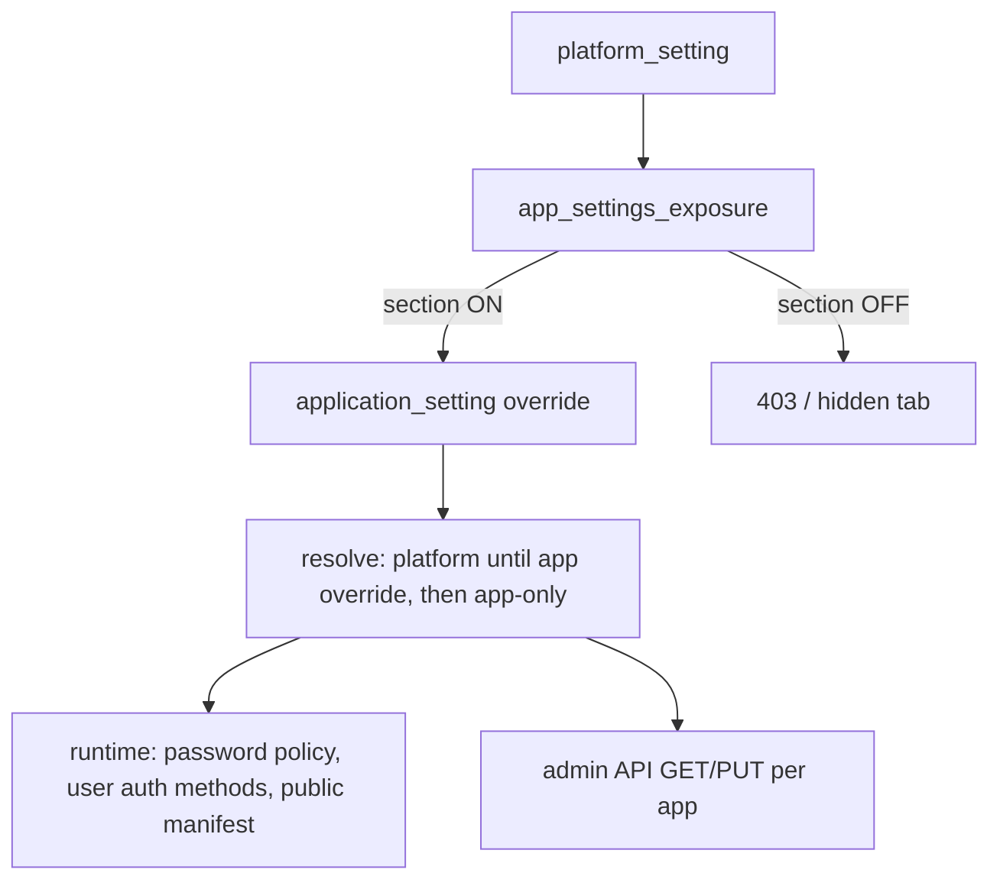
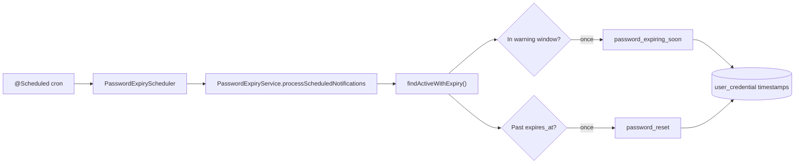

# Settings governance

SecureOne separates **platform policy** from **per-application overrides**. Application admins only see and edit sections the platform explicitly exposes.

## Flow



1. **Platform** (`/settings` or `/api/admin/v1/settings/*`) — super admin sets defaults and SMTP, auth catalog, flags, etc.
2. **For applications** — toggles which sections appear under each app’s **Settings** (`app_settings_exposure`).
3. **Application** (`/app/{id}/settings`) — only exposed sections. A section **follows the platform** until its first saved change, which gives the application its own copy in `application_setting` (opening a page never does). A bar above each section says which it is and offers **Reset to platform** (`PUT .../settings/policy-source/{section}` with `platform`). V76 removed copies that only repeated the platform value, made by older consoles on page load.
4. **Platform minimums** — for **Password policy**, **Verification & OTP**, **OAuth tokens** and **Sign-in methods**, an application can be stricter than the platform, never weaker (`PlatformMinimums`). A weaker save is refused with what the platform requires; values saved before the platform tightened are raised when read, so a stricter platform reaches every application. Sign-in methods the platform has off are off for every application.
5. **Public API** (`GET /api/v1/applications/{id}`) — optional unauthenticated manifest; requires exposure **and** per-app `enabled`.

## Exposure section keys

| Exposure key | Application setting key | Admin tab |
|--------------|-------------------------|-----------|
| `notifications` | `notifications` | Notifications (alerts) |
| `email` | `email` | Notifications (sender) |
| `auth-methods` | `auth_methods` | Authentication, MFA |
| `password-policy` | `password_policy` | Password policy |
| `feature-flags` | `feature_flags` | Feature flags |
| `appearance` | `appearance` | Appearance (client app theme for public API; separate from platform admin console theme) |
| `user-directory` | `user_directory` | User directory |
| `public-manifest` | `public_manifest` | Public API |
| `token-policy` | `token_policy` | OAuth tokens (TTL, refresh rotation) — the app's own policy exists only while its switch is on |
| `verification-policy` | `verification_policy` | Verification (signup link vs OTP, OTP TTL, SMS) |

### Verification & OTP

**Platform → Settings → Verification** (and per-app when exposed):

| Setting | Effect |
|---------|--------|
| Default mode | `link` (email URL) or `otp` (numeric code) for signup |
| OTP length / TTL / max attempts | Code format and security |
| SMS provider | Platform-only: `log` (dev) or Twilio |

Enable **email OTP login** (`m_email_otp`) and **SMS OTP login** (`m_sms`) under Authentication → MFA. Full API reference: [Verification & OTP](../integrate/verification-and-one-time-codes.md).

### OAuth tokens (two-step enable)

1. **Platform → For applications → OAuth tokens tab** — allows apps to have their own token policy.
2. **Application → Settings → Feature flags → Own OAuth token policy** — on: the application gets its own `token_policy`, starting from the platform's (never longer-lived than it); off: the row is removed and the platform's policy applies. The switch *is* the override: there is no separate `tabEnabled` (V76 removed it, and removed policies saved while it was off, which the token endpoint had still been applying).
3. When both are on, the **OAuth tokens** tab appears and policy can be edited.

### Two Factor Authentication (application's own settings)

1. **Platform → For applications → Two Factor Authentication** (exposure key `two-factor`, separate from **Sign-in methods** `auth-methods`; V73 starts it at the value Authentication had) — allows apps to have their own two-factor settings.
2. **Application → Settings → Feature flags → Settings tabs** — switch **Two Factor Authentication** (stored as `tabEnabled` in `auth_mfa_tab`, API `/settings/mfa-tab/tab-enabled`; audited as `settings.feature_flag_changed`).
3. When both are on, **Authentication → Two Factor Authentication** appears and the application's own values **apply at sign-in**. When the switch is off, two-factor is **off for that application**: no second step or setup at sign-in, and its console hides the users' Two-step tab, 2FA badges and filter. Exception: a platform or tenant lock on **mode** (locked or only stricter) still applies. Values it saved earlier are kept for when the switch is turned on again, and saving new ones is refused. When the platform does not open Two Factor Authentication to applications, every application uses the platform and tenant settings.
4. **Backup codes per user** (`recoveryCodesPerEnrollment`) is never an application setting: backup codes are one set per user for every application.
5. State the settings drive is per application: setup deadline, skips, "don't ask again", reminders and exemptions in `user_two_step_state (user_id, application_id)` (zero UUID = no application / every application), and remembered devices in `trusted_device.application_id` with one cookie per application.

### Feature flags catalog

The Feature flags tab (platform and application) lists only flags that **affect applications today**. OAuth grants, SAML, SCIM, and similar capabilities are configured elsewhere (auth methods, OAuth client config, exposure toggles) until wired to runtime checks.

**Active flags (4):**

| Key | Default | How it is used |
|-----|---------|----------------|
| `self_service_recovery` | ON | Blocks `POST /api/v1/applications/{id}/account/password/forgot` when OFF (`AccountNotificationService`). Magic link login uses the **auth method** `m_magic`, not this flag. |
| `self_registration` | OFF | Blocks public signup API when OFF (`ApplicationSignupService`). Also requires password auth method enabled + implemented. Public manifest `signup.enabled` mirrors this flag. |
| `ldap` | OFF | Blocks LDAP import API when OFF (`UserImportExportService`). Forces `sources.ldap.enabled = false` on user-directory save when OFF. Admin UI hides LDAP source/import when OFF. |
| `notification_email_test_ui` | ON | Shows or hides the SMTP test panel under **Application → Notifications** (admin UI only). |

Application effective flags = platform catalog merged with optional `application_setting.feature_flags` patches by `key`. **Platform is the master switch:** a flag is active for an application only when it is **ON at platform** and **ON for the application** (`effective = platform ∧ app`). Application admins cannot enable a flag while platform has it OFF; the toggle is disabled in the UI and saves are clamped server-side.

**Platform defaults** for active flags: `self_service_recovery` and `notification_email_test_ui` default **ON**; `self_registration` and `ldap` default **OFF** (opt-in at platform, then per app).

Capabilities removed from the flag catalog (OAuth grants, SAML, social login, passkeys, SCIM, etc.) are **not flag-gated** — they use auth methods, OAuth client config, and exposure toggles instead, and remain available when those settings allow them.

Setting exposure `feature-flags` controls whether app admins can edit overrides; runtime enforcement uses effective flags even when the tab is hidden.

**Removed from catalog** (were UI-only placeholders with no application impact):

| Key | Former category | Why removed |
|-----|-----------------|-------------|
| `oauth_authorization_code_pkce` | oauth | OAuth behavior not flag-gated; use OAuth client + token policy settings |
| `oauth_refresh_tokens` | oauth | Same |
| `oauth_client_credentials` | oauth | Same |
| `oauth_device_code` | oauth | Same |
| `oauth_token_introspection` | oauth | Same |
| `oauth_token_revocation` | oauth | Same |
| `oauth_pushed_authorization` | oauth | Same |
| `dpop` | oauth | Same |
| `adaptive_mfa` | identity | MFA/risk handled via auth methods and MFA tab, not this flag |
| `device_trust` | identity | Not implemented |
| `passwordless` | identity | Passkeys/passwordless via auth methods (`m_passkey`, etc.) |
| `social_login` | identity | Social/OIDC via auth methods |
| `saml` | identity | SAML via auth method `m_saml` |
| `scim_provisioning` | provisioning | Not implemented |

Removed keys are not part of the stored platform and application flag JSON.

`application.config` (OAuth client metadata) is separate from policy settings.

## Standards the settings keep to

Application (and platform) settings are limited so they cannot drift below the usual standards. Values stored before these limits are read within them; V77 tidied what was stored.

| Area | Rule | Standard |
|------|------|----------|
| Integration › client URLs | Forgot-password, password-reset and magic-link pages must be `https://` (plain `http://` only for localhost) on a site the application's OAuth clients redirect to (`ClientUrlPolicy`). Others are refused on save and skipped when sending (links then use the hosted pages). | OWASP ASVS; RFC 9700 |
| Email templates | Emails carrying a reset/sign-in link or a code never have CC/BCC. Security notices (password changed, sign-in changes, account locked) are always sent, whatever the template switch or "User email" says. Values are HTML-escaped in HTML bodies. | ASVS V2.5, V5.3; NIST SP 800-63B §6.1.2.3 |
| Verification codes | 6–8 digits, valid 1–10 minutes (two-step codes too). | NIST SP 800-63B §5.1.3 |
| Password policy | Defaults: 12+ characters, leaked-password check on, no character-type rules, no expiry. Up to 128 characters. New passwords are hashed with Argon2id; bcrypt hashes from before still work and are replaced at the next sign-in. The editor warns when an application has 2FA off and a minimum under 15. | NIST SP 800-63B §3.1.1; OWASP Password Storage |
| SMTP | Certificates are checked against the host name. "None" (no TLS) only for a mail server on this machine or an internal service name. | ASVS V9 |
| OAuth tokens | Access, ID and client-credentials tokens at most 1 hour; authorization codes at most 10 minutes; refresh tokens have an idle lifetime (renewed by each rotation) and a maximum lifetime (`refreshTokenAbsoluteSeconds`, default 30 days). | RFC 9700; RFC 6749 §4.1.2 |
| Sign-in session | Platform: `secureone.session.max-lifetime` (24 h). Each application can ask people to sign in again sooner (`signInMaxAgeSeconds`, OAuth tokens tab), applied on `/oauth2/authorize` like OIDC `max_age`. | NIST SP 800-63B §7 |
| Appearance | Colours must be hex, the logo an `https://` address, names plain text; bad values are refused, and stored ones fall back to the default. | ASVS V5 |
| Public API | The manifest no longer names the password hash algorithm. | — |

## Password policy resolution

Applications **inherit the platform password policy** until an application admin saves an override under **Application → Settings → Password policy**. After that:

- The application uses its stored `application_setting.password_policy`, raised to the platform minimums (see Flow, step 4).
- Other platform changes no longer affect that application until the override is cleared (**Reset to platform**, `DELETE .../settings/password-policy`).

Runtime enforcement (set/reset/change password, signup, admin set password) uses the resolved policy for the active `applicationId`. Token flows resolve `applicationId` from the invite/reset context or user membership when possible; otherwise platform policy applies.

Enforced fields:

| Field | Enforced |
|-------|----------|
| `minLength`, complexity toggles | Yes — on every password set/change |
| `historyCount` | Yes — compared against recent credential hashes |
| `expiryDays` | Yes — stamped on credential at set time; login blocked when expired; see [Password expiry notifications](#password-expiry-notifications) |
| `hashAlgorithm` | Yes — stored on credential (`bcrypt` only today) |

## Password expiry notifications

When `expiryDays` is greater than zero, SecureOne enforces password lifetime end-to-end: credential stamping, proactive email warnings, automatic reset on expiry, and login blocking with a clear user message.

### Never expires (`expiryDays = 0`)

Setting **Password expiry (days)** to **0** means the password **never expires**:

- New credentials get `user_credential.expires_at = NULL`.
- No expiry warning or expired-reset emails are sent.
- Login is never blocked for password age.

This is the platform and application default when expiry is disabled.

### When expiry is enabled (`expiryDays > 0`)

1. **At password set** (signup, invite, reset, admin set password, change password) the active resolved policy’s `expiryDays` is stamped on the new current credential as `expires_at = now + expiryDays`.
2. **Before expiry** — a **warning email** is sent once per credential when the password enters the warning window (by default **7 days before** expiry, or fewer if `expiryDays` is less than 7).
3. **After expiry** — a **password reset email** is sent once per credential (same reset flow as forgot-password; no admin security alert for this automated path).
4. **On login** — if the current credential is expired, sign-in is **rejected**, the reset email is sent if not already sent for that credential, and the user sees a dedicated expired-password message.

Policy resolution follows the same rules as other password policy fields: platform until the application saves an override, then the application snapshot only.

### User-facing messages

| Surface | Behavior |
|---------|----------|
| Form login (`/login.html`) | Redirect to `?error=expired` with copy explaining the password expired and that a reset link was emailed |
| Session API login (`POST /api/v1/auth/session/login`) | `401` with message: *Your password has expired and you cannot sign in. A password reset link has been sent to your email address.* |
| Login history / diagnostics | Failure reason `password_expired` |

Users recover access by completing the emailed reset link (or using forgot-password). Token-based reset calls `setPassword`, which issues a new credential with a fresh `expires_at` from the resolved policy.

### Email templates

| Template key | When sent |
|--------------|-----------|
| `password_expiring_soon` | Credential is in the warning window and `expiry_warning_sent_at` is null |
| `password_reset` | Credential is past `expires_at` and `expiry_expired_notice_sent_at` is null (scheduled job or login attempt) |

Both use **application** SMTP and notification settings (`userEmailEnabled` must be on). If no application context can be resolved for the user, delivery is skipped and a warning is logged.

Template variable `{{expiryDate}}` is set on the warning email (UTC, medium date/time format).

### Scheduled job (`PasswordExpiryScheduler`)

Password expiry emails are driven by a **Spring `@Scheduled` background job** in the auth-server. Scheduling is enabled on `AuthServerApplication` (`@EnableScheduling`). The job bean is `PasswordExpiryScheduler`; it delegates to `PasswordExpiryService.processScheduledNotifications()`.



#### What each run does

1. Load all **current** credentials where `expires_at IS NOT NULL` (ordered by expiry).
2. Skip missing users and **suspended** accounts.
3. Resolve **application** context for SMTP (first linked app, or membership fallback).
4. For each credential at `now`:
   - **Expired** → send reset email if `expiry_expired_notice_sent_at` is null; set that timestamp.
   - **Not expired but in warning window** → send `password_expiring_soon` if `expiry_warning_sent_at` is null; set that timestamp.
5. Return the count of emails sent; log at **INFO** only when that count is greater than zero.

Failures for a single user (e.g. SMTP misconfiguration) are logged at **WARN** and do not stop the rest of the batch. Uncaught errors in the job are caught and logged at **WARN** so the scheduler keeps running on the next tick.

#### Configuration

Defined in `apps/auth-server/src/main/resources/application.yml`:

```yaml
secureone:
  password-expiry:
    scheduler-enabled: true          # SECUREONE_PASSWORD_EXPIRY_SCHEDULER
    check-cron: "0 0 */6 * * *"      # SECUREONE_PASSWORD_EXPIRY_CRON
```

| Setting | Env override | Default | Purpose |
|---------|--------------|---------|---------|
| `secureone.password-expiry.scheduler-enabled` | `SECUREONE_PASSWORD_EXPIRY_SCHEDULER` | `true` | When `false`, the `PasswordExpiryScheduler` bean is not registered (`@ConditionalOnProperty`) |
| `secureone.password-expiry.check-cron` | `SECUREONE_PASSWORD_EXPIRY_CRON` | `0 0 */6 * * *` | Spring **6-field** cron: `second minute hour day-of-month month day-of-week` |

**Default schedule:** at second `0`, minute `0`, every **6 hours** (`*/6` in the hour field) — i.e. 00:00, 06:00, 12:00, and 18:00 server time.

**Example cron values:**

| Expression | Meaning |
|------------|---------|
| `0 0 */6 * * *` | Every 6 hours (default) |
| `0 0 9 * * *` | Once daily at 09:00 |
| `0 0 8,17 * * MON-FRI` | 08:00 and 17:00 on weekdays |
| `0 */30 * * * *` | Every 30 minutes (useful in dev/testing only) |

There is **no admin UI** for the scheduler — only YAML or environment variables.

**Disable locally or in tests:**

```dotenv
SECUREONE_PASSWORD_EXPIRY_SCHEDULER=false
```

#### Scheduler vs login-triggered email

| Trigger | Warning email | Expired reset email |
|---------|---------------|---------------------|
| Scheduled job | Yes, when in warning window | Yes, when past `expires_at` |
| Expired login attempt | No | Yes, if not already sent for that credential |

So users who never log in still receive the approaching-expiry notice and the post-expiry reset from the job. Users who try to sign in after expiry get the reset immediately even if the job has not run yet.

#### Idempotency and multiple instances

Each credential stores `expiry_warning_sent_at` and `expiry_expired_notice_sent_at`. At most **one** warning and **one** expired-reset email are sent per password generation, regardless of how many times the job runs or which auth-server instance handles it. If several replicas run the same cron, duplicate sends are unlikely because the first successful save sets the timestamp; a second attempt sees it already set.

#### Logging

| Event | Level | Message pattern |
|-------|-------|-----------------|
| Job sent one or more emails | INFO | `Password expiry job sent N notification(s)` |
| Per-user send failure | WARN | `Failed to send password expiry warning…` / `Failed to send expired-password reset…` |
| Whole job failure | WARN | `Password expiry notification job failed: …` |

Search auth-server logs for `PasswordExpiryScheduler` or `PasswordExpiryService` when debugging missed notifications.

### Data model (`user_credential`)

| Column | Purpose |
|--------|---------|
| `expires_at` | Absolute expiry instant; `NULL` when policy had `expiryDays = 0` at set time |
| `expiry_warning_sent_at` | When the approaching-expiry email was sent (null = not yet sent) |
| `expiry_expired_notice_sent_at` | When the post-expiry reset email was sent (null = not yet sent) |

### Implementation notes

- **Login enforcement:** `PasswordExpiryService.enforceLoginAllowed` (used by `TenantPasswordAuthenticationProvider` after password match).
- **Scheduled processing:** `PasswordExpiryScheduler` → `PasswordExpiryService.processScheduledNotifications` (see [Scheduled job](#scheduled-job-passwordexpiryscheduler) above).
- **Change password while logged in:** `PasswordPolicyService.assertNotExpired` still applies if a session somehow holds a credential that expired mid-session; normal expired users cannot sign in to reach that path.

## Enforcement status
|------|----------------|---------------------------|
| User directory import/export | Yes | Yes |
| User `allowedAuthMethods` | Yes | Yes (app-scoped admin) |
| Admin set password | Yes | Yes (app-scoped endpoint + policy) |
| Public manifest / signup hints | Yes | Yes |
| Password reset / invite (token flows) | N/A | Yes when `applicationId` can be resolved; else platform |
| Self-registration | N/A | Yes (application-scoped) |
| Login (`TenantPasswordAuthenticationProvider`) | N/A | Expiry check + reset email on expired login; auth method from platform |
| Platform notifications | N/A | Independent from application notifications |

Use `ApplicationEffectiveSettingsService` when wiring login and account flows to a `client_id` / application context.

## Appearance (two separate themes)

| Scope | Storage | Used by |
|-------|---------|---------|
| **Platform** | `platform_setting.appearance` | SecureOne **admin console** only (`ThemeProvider`, `/settings` → Appearance) |
| **Application** | `application_setting.appearance` | **Client apps** via public manifest when `sections.appearance` is enabled |

Application appearance includes branding (`appName`, `logoUrl`), the same color/gradient/toast controls as platform, plus widget colors (dialogs, inputs, dividers). It does **not** inherit the platform admin theme.

## Access control

| Who | Platform settings (`/settings`, `/api/admin/v1/settings/*`) | Application settings (`/app/{id}/settings`) |
|-----|---------------------------------------------------------------|---------------------------------------------|
| Platform operator (`admin` / `spring.security.user.name`) | View and edit | Via app console |
| Same account with `SECUREONE_ACT_AS_EMAIL` set | **Denied** (simulating a tenant user) | Allowed for granted apps |
| Tenant Admin, Member, app “Super Admin” role | **Denied** | Only exposed sections for their apps |

Tenant admins never see **Platform settings** in the sidebar. The `/settings` route returns 404 for them.

## Self-registration (application end users)

Integrated clients (e.g. an e-commerce app using SecureOne for identity) can let users create their own accounts when:

1. **Platform → For applications → Feature flags** is exposed for the app.
2. **Application → Settings → Feature flags** — enable **Self Registration** (`self_registration`).
3. **Authentication** — password method enabled and implemented (`m_password`).
4. **Public API** — manifest exposure on (optional; manifest includes a `signup` block with endpoints).

| Endpoint | Purpose |
|----------|---------|
| `GET /api/v1/applications/{id}/signup` | Whether sign-up is open, password policy hints, hosted page URL |
| `POST /api/v1/applications/{id}/signup` | Register (`email`, `password`, optional name fields) |

Hosted UI: `/account/signup.html?applicationId={id}` (links from `/login.html?applicationId={id}`). New users get app membership, the app’s default role (if configured), and a verification email. Sign in with tenant username `slug:email@domain.com`.

For hosted vs native/custom end-user UI (OAuth, magic link, session login, email link behavior), see [Authentication UI integration](../integrate/hosted-and-native-sign-in.md).

**Until email is verified**, password sign-in is blocked. Application admins can open a user → **Security** → **Verify email (allow sign-in)** (or resend the verification link). API: `POST /api/admin/v1/applications/{applicationId}/users/{userId}/email/verify`.

## Operations

- After new migrations, restart **auth-server** (`./gradlew bootRun` in `apps/auth-server`).
- Dev login: `admin` / `admin` (no `SECUREONE_ACT_AS_EMAIL` for platform work); example app: `22222222-2222-2222-2222-222222222201`.
