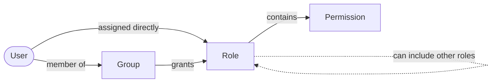

# Application roles and permissions

How operators manage **groups**, **roles**, and **permissions** for an integrated application in the admin console.

Related: [Admin control](../install/admin-control.md), [Applications & OAuth clients](applications-and-oauth-clients.md).

## Where RBAC data lives

| Mode | `application.schema_name` | Tables |
|------|---------------------------|--------|
| **Isolated** (new apps) | e.g. `exampleapp` | `{schema}.role`, `{schema}.permission`, … |
| **Legacy** (pre-isolate) | `NULL` | `platform.role`, `platform.permission`, … |

API paths are unchanged (`/api/admin/v1/applications/{applicationId}/…`). Auth-server sets `search_path` per request so JPA hits the correct schema.

## Console sections

| Section | Route | Purpose |
|---------|-------|---------|
| **Groups** | `/app/{applicationId}/groups` | Bundle multiple roles; assign users to the group |
| **Roles** | `/app/{applicationId}/roles` | Role directory, composite inheritance, direct permissions, assigned users |
| **Permissions** | `/app/{applicationId}/permissions` | Permission catalog; assign or remove keys on roles |

All three require `role:read` and their matching console feature (`console:groups`, `console:roles`, or `console:permissions`) when tenant governance caps console sections.

## Effective access model



A user's permissions are those of every role they hold, directly or through their groups (tables: `user_role`,
`rbac_group_member`, `rbac_group_role`, `role_permission`).

**Effective permissions** for an operator in the admin console = union of:

1. Permissions from **direct** `user_role` assignments (including composite child roles), and  
2. Permissions from all roles linked to **groups** the user belongs to.

### What your application receives

Every user access token issued to one of the application's OAuth clients carries the user's access in
**that application**, and `/userinfo` returns the same values:

```json
{
  "roles": ["Approver", "Manager", "Viewer"],
  "permissions": ["orders:approve", "user:read"]
}
```

- `roles`: roles assigned directly, roles granted through groups, and the child roles of composite roles (recursively).
- `permissions`: every permission carried by those roles.
- Changes apply to the next token (sign-in or refresh); existing access tokens keep their claims until they expire.
- Client-credentials tokens (no user) carry neither claim.

Other notes:

- Assigning roles while editing a user in an application changes only that application's roles.
- A role that is still assigned to users cannot be deleted (409); unassign it first.
- Removing a user from an application does not block them if the application allows self-registration: they can join again by signing in. Turn self-registration off to make removal stick.

## Groups

A **group** is an application-scoped named bundle:

- Assign **one or many roles** to the group (`rbac_group_role`).
- Add **members** (`rbac_group_member`) — users in the same tenant.
- Members inherit all group roles **without** creating individual `user_role` rows.

### API (application-scoped)

Base: `/api/admin/v1/applications/{applicationId}/groups`

| Method | Route | Action |
|--------|-------|--------|
| GET | `/groups` | List groups |
| GET | `/groups/{groupId}` | Detail (roles + members) |
| POST | `/groups` | Create |
| PUT | `/groups/{groupId}` | Update (replace-all roles and members) |
| DELETE | `/groups/{groupId}` | Delete |

### When to use groups vs direct roles

| Use groups when… | Use direct `user_role` when… |
|------------------|------------------------------|
| Many users share the same role set (e.g. “Support team”) | One-off grants for a single user |
| You want to add/remove a role bundle in one place | Role assignment is managed per user on the Users page |
| Onboarding: add user to one group instead of many checkboxes | Temporary or time-bound grants (future: `expires_at` on `user_role`) |

## Roles

Each application has its own role namespace (`role.application_id`).

| Capability | UI | API |
|------------|-----|-----|
| Create / edit / delete custom roles | Roles → New role / **Edit role** | `POST/PUT/DELETE …/roles` |
| Edit built-in / system roles | **Edit role** — description, permissions, inheritance (name locked) | `POST/PUT …/roles` |
| Composite inheritance | Edit role → child roles; Overview links to child roles | `childRoleIds` on create/update |
| Direct permissions | Role detail → **Permissions** tab (inline toggles) | `POST/DELETE …/roles/{id}/permissions/{permId}` |
| Assigned users | Role detail → **Assigned users** tab | `GET …/roles/{id}/users` |

Built-in and system roles (Member, Security Auditor) **can be edited** — update description, permissions, and composite inheritance. Only **rename** and **delete** are blocked. Console operator roles (Tenant Admin, Application Admin) are not shown in application RBAC.

Deep link to a role: `/app/{applicationId}/roles?roleId={uuid}`.

## Permissions

The **permission catalog** (`permission` table) defines atomic keys (`resource:action`).

| Capability | UI | API |
|------------|-----|-----|
| Seed defaults | Install default permissions | `POST …/permissions/seed-defaults` |
| CRUD catalog entries | Permissions page | `POST/PUT/DELETE …/permissions` |
| Assign to roles | Permission detail → **Role assignment** tab | Per-role assign/remove endpoints above |
| Delete guard | Disabled while `roleCount > 0` | Service rejects if still assigned |

## Suggested admin workflow

1. **Permissions** — seed defaults or add custom keys (`invoice:read`, etc.).
2. **Roles** — create roles; assign permissions (inline or edit modal); optionally mark composite and inherit child roles.
3. **Groups** — create groups; assign multiple roles; add members.
4. **Users** — direct role assignment for exceptions; groups for team-wide access.

## Database

| Table | Purpose |
|-------|---------|
| `rbac_group` | Group metadata per application |
| `rbac_group_role` | M:N group ↔ role |
| `rbac_group_member` | M:N group ↔ user |

## Future enhancements

| Enhancement | Status |
|-------------|--------|
| Inline group role/member edit without modal | Planned — today use Edit group |
| Assign users to roles from role page | View-only today; use Users page or Groups |
| Show groups that include a role | Planned |
| OAuth token claims include group roles | Admin console only today |
| Time-bound `user_role.expires_at` | Column exists; not enforced in UI |
| Nested groups | Not planned — use composite roles instead |
| Permission import/export (CSV) | Not implemented |
| Effective-permission preview for a user | Not implemented |

