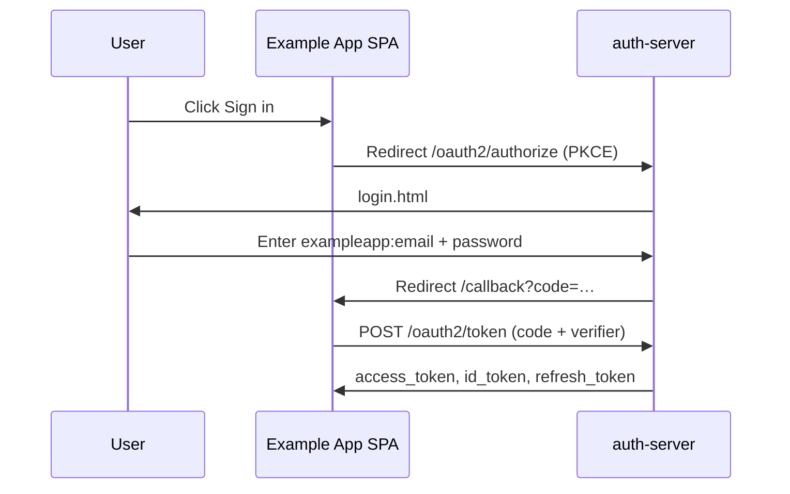
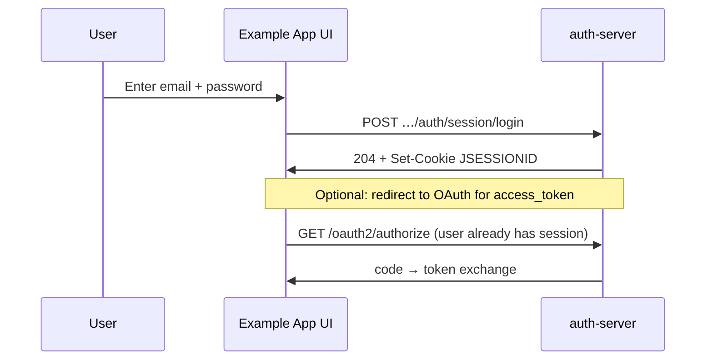

# Integration guide

**Audience:** You are a **developer** building a product (e.g. a new online-store frontend) and want SecureOne to handle **signup**, **sign-in**, **password reset**, and **tokens**.

**Prerequisite:** A platform operator has registered your application and OAuth client. If not, see **[Operator getting started](../get-started/operator-getting-started.md)** § “Your first hour”.

---

## Fastest path: Connect an app (console)

**Console → Connect an app** (`/admin/connect`) registers an app and hands you working setup code:

1. **Pick what you are building**: web app with a server, single-page app, mobile app, backend service, TV / command-line app, or an API that accepts SecureOne tokens.
2. **Pick the framework and URLs.** The redirect URL is filled in from the framework's convention (for example `/api/auth/callback/secureone` for Next.js, `/login/oauth2/code/secureone` for Spring Boot, `/signin-oidc` for ASP.NET Core, `com.example.app:/oauthredirect` for mobile).
3. **Create client.** The client gets the secure settings for that kind of app:

| Kind | Client | Grants | Secret |
|------|--------|--------|--------|
| Web app with a server | `web` | authorization code + PKCE, refresh token | yes (shown once) |
| Single-page app | `spa` | authorization code + PKCE, refresh token | no |
| Mobile app | `native` | authorization code + PKCE, refresh token | no |
| Backend service | `m2m` | client credentials | yes (shown once) |
| TV / CLI | `native` | device code, refresh token | no |
| API | — (nothing to register) | — | — |

4. **Copy the setup** for your framework (Next.js, Spring Boot, Express, ASP.NET Core, React, Angular, plain JavaScript, React Native, Android, iOS, Flutter, curl, Node.js, Java, Python) with your issuer, client ID and URLs filled in. Secrets are read from `SECUREONE_CLIENT_SECRET`, never written into code.
5. **Test sign-in.** Opens `/account/connect-test.html` on the auth-server and runs a real authorization-code + PKCE sign-in with the new client: public clients go on to exchange the code and call `/userinfo`; confidential clients stop at the code (the secret stays with your server). The test page's URL is registered as an extra redirect URI; remove it on the client page once your app works.

Browser origins of the redirect URIs you register are allowed for CORS automatically (see § CORS below), so a single-page app works without a server configuration change.

---

## Example: Example App web app

Throughout this guide we use a fictional **Example App Web** app:

| Item | Example value |
|------|---------------|
| Tenant slug | `exampleapp` |
| Application name | Example App Web |
| Application ID | `aaaaaaaa-bbbb-cccc-dddd-eeeeeeeeeeee` (UUID from admin) |
| OAuth client ID | `exampleapp-web` |
| Frontend dev URL | `http://localhost:5173` |
| OAuth callback | `http://localhost:5173/callback` |
| Auth-server (issuer) | your SecureOne address |

Replace these with your real values from **Admin → Applications → your app → Settings → Integration**.

---

## Two ways to integrate login UI

SecureOne supports two integration modes. You choose **one per application** (configured in admin, implemented in your frontend).

| Mode | Who renders login/signup? | Best for |
|------|---------------------------|----------|
| **Hosted** (`authUiMode: hosted`) | SecureOne pages on auth-server | Fastest integration, standard OIDC |
| **Native** (`authUiMode: native`) | Your own UI | Full branding, custom UX |

Both flows side by side: [diagram](../diagrams/auth-flow-hosted-vs-native.drawio). Both are verified end to end in a real browser (switching the mode in the console, the manifest value, the hosted redirect, native session login + silent PKCE).

### How to tell SecureOne which mode you use

**This is configuration, not a per-request API flag.** Set it once in the admin console:

1. **Application console → Settings → Integration → Authentication UI**
2. Choose **Hosted SecureOne UI** or **Native / custom UI**
3. Save

Equivalent admin API (requires operator session or admin credentials):

```http
PUT /api/admin/v1/applications/{applicationId}/settings/client-integration
Content-Type: application/json

{
  "authUiMode": "native",
  "clientUrls": {
    "forgotPassword": "https://shop.example.com/account/forgot",
    "passwordReset": "https://shop.example.com/account/reset",
    "magicLink": ""
  },
  "checklist": { ... },
  "notes": "Example App branded auth"
}
```

| Field | Values | Effect |
|-------|--------|--------|
| `authUiMode` | `"hosted"` or `"native"` | The mode chosen in the console; read it from the manifest. Advisory: **your frontend implements it**, and both flows keep working |
| `clientUrls.forgotPassword` | Your page URL | Shown in integration docs; your UI calls forgot-password API |
| `clientUrls.passwordReset` | Your page URL | Reset **emails** link here with `?token=…&applicationId=…` appended |
| `clientUrls.magicLink` | Reserved | Magic-link emails still use hosted page today |

**Your frontend discovers endpoints** from the public manifest (no admin auth):

```http
GET /api/v1/applications/{applicationId}
```

The `account` block lists every API path and hosted page URL. When `clientUrls` are configured, they appear under `account.clientUrls`.

> **Important:** SecureOne does not automatically switch UI when an end user visits your site. **You** either redirect to OAuth/hosted pages (`hosted`) or call account APIs from your React/Vue app (`native`). The `authUiMode` setting keeps your team aligned, filters the console's API reference, and is published in the manifest so your app can branch on it at runtime.

---

## Step 0 — Collect your identifiers

| Value | Where to find it |
|-------|------------------|
| **Application ID** (UUID) | Admin → Applications → Integration settings header |
| **OAuth client ID** | Same page, or OAuth client detail |
| **Client secret** | Shown once at registration (confidential web apps only; SPAs use PKCE, no secret) |
| **Tenant slug** | Admin → Tenants |
| **Issuer URL** | your SecureOne address or `SECUREONE_ISSUER_URL` |

---

## Step 1 — Enable public discovery

Your frontend needs the manifest. An operator must:

1. **Platform settings** → expose **Public manifest** to applications
2. **Application settings** → **Public manifest** → enabled
3. **Feature flags** → enable **Self Registration** if you offer signup

Test:

```http
GET $SECUREONE_URL/api/v1/applications/{applicationId}
```

Example response (trimmed):

```json
{
  "applicationId": "aaaaaaaa-bbbb-cccc-dddd-eeeeeeeeeeee",
  "manifestEnabled": true,
  "application": {
    "id": "aaaaaaaa-bbbb-cccc-dddd-eeeeeeeeeeee",
    "name": "Example App Web",
    "slug": "exampleapp-web",
    "status": "active"
  },
  "authMethods": [
    { "key": "m_password", "enabled": true, "implemented": true },
    { "key": "m_email_otp", "enabled": true, "implemented": true }
  ],
  "featureFlags": [
    { "key": "self_registration", "enabled": true }
  ],
  "verification": {
    "signup": { "defaultMode": "link", "allowedModes": ["link", "otp"] },
    "login": { "identifierTypes": ["email", "phone"], "passwordlessModes": ["email_otp", "magic_link"] }
  },
  "signup": {
    "enabled": true,
    "endpoint": "/api/v1/applications/aaaaaaaa-…/signup"
  },
  "account": {
    "sessionLoginEndpoint": "/api/v1/applications/aaaaaaaa-…/auth/session/login",
    "otpLoginRequestEndpoint": "/api/v1/applications/aaaaaaaa-…/auth/otp/request",
    "otpLoginVerifyEndpoint": "/api/v1/applications/aaaaaaaa-…/auth/otp/verify",
    "forgotPasswordEndpoint": "/api/v1/applications/aaaaaaaa-…/account/password/forgot",
    "verifyOtpConfirmEndpoint": "/api/v1/applications/aaaaaaaa-…/account/verify/otp/confirm",
    "hostedLoginPage": "/login.html?applicationId=aaaaaaaa-…",
    "hostedSignupPage": "/account/signup.html?applicationId=aaaaaaaa-…",
    "clientUrls": {
      "forgotPassword": "https://shop.example.com/account/forgot",
      "passwordReset": "https://shop.example.com/account/reset"
    }
  }
}
```

**Call this once at app startup** (or cache with TTL). Use the returned paths — do not hardcode URLs in production.

OIDC discovery (issuer-level):

```http
GET $SECUREONE_URL/.well-known/openid-configuration
```

---

## Step 2 — Choose your integration path

### Path A — Hosted UI (recommended to start)

Your app never renders a password field. Users are redirected to SecureOne.



**Authorize URL** (build in your SPA):

```
GET $SECUREONE_URL/oauth2/authorize
  ?response_type=code
  &client_id=exampleapp-web
  &redirect_uri=http://localhost:5173/callback
  &scope=openid profile email
  &state={random}
  &code_challenge={BASE64URL_SHA256_verifier}
  &code_challenge_method=S256
```

**Token exchange** (after callback):

```http
POST $SECUREONE_URL/oauth2/token
Content-Type: application/x-www-form-urlencoded

grant_type=authorization_code
&code={authorization_code}
&redirect_uri=http://localhost:5173/callback
&client_id=exampleapp-web
&code_verifier={original_verifier}
```

**User identifier at hosted login:** `exampleapp:user@example.com` (tenant slug + email).

Hosted pages (can link directly):

| Page | URL |
|------|-----|
| Login | `/login.html?applicationId={applicationId}` |
| Signup | `/account/signup.html?applicationId={applicationId}` |
| Forgot password | `/account/forgot-password.html?applicationId={applicationId}` |

The hosted sign-in page follows the application's settings: password, one-time code by email or SMS, passkeys,
partner SSO buttons (configured federation providers), the MFA step, and links to sign-up and magic link only
when those are enabled. The hosted sign-up page asks for the verification code itself when the app verifies by
code, and shows a mobile-number field when the policy uses phone.

---

### Path B — Native / custom UI (your own branding)

Your React app renders its own branded forms and calls SecureOne **public APIs**. No redirect to `login.html`.



#### Sign in with password

```http
POST /api/v1/applications/{applicationId}/auth/session/login
Content-Type: application/json

{
  "identifier": "user@example.com",
  "password": "SecurePass123!"
}
```

- `identifier` = email or phone (E.164, e.g. `+919876543210`)
- Success: `204 No Content` + `Set-Cookie: JSESSIONID=…` (session in Redis)
- **MFA:** `428` with `{ "mfaChallengeId": "…" }` when the user has an authenticator (or the app requires MFA).
  Finish with `POST /api/v1/auth/mfa/totp/verify` `{ "mfaChallengeId", "code" }` (or `/api/v1/auth/mfa/recovery/verify`
  with a recovery code) → `204` and the session.
- Failure: `401` with the same message whether the email is unknown, unverified or the password is wrong
  (the response never tells an attacker which emails have accounts). After the app's failed-attempt limit
  the account is locked for the configured minutes and the user is emailed.
- Tenant is resolved from the application — you do **not** send tenant slug in the body

For **API access tokens**, still use OAuth after session login (user won’t see login again):

```
GET /oauth2/authorize?...  (same PKCE flow; session cookie sent automatically if same-site)
```

Or use the TypeScript SDK: `packages/secureone-client`.

#### Sign in with email/SMS OTP

```http
POST /api/v1/applications/{applicationId}/auth/otp/request
{ "identifier": "user@example.com", "channel": "email" }

POST /api/v1/applications/{applicationId}/auth/otp/verify
{ "challengeId": "uuid-from-request", "code": "123456" }
```

Requires `m_email_otp` or `m_sms` enabled in auth methods (otherwise `403`). Use `"channel": "sms"` with a phone
number as `identifier`.

- The request **always** answers `200` with a `challengeId` (and the same message), also for an unknown
  identifier: the code just never arrives and no code verifies it. Show "If an account exists, we sent a code".
- Verify answers `204` (session) or `428` with `mfaChallengeId` (same MFA step as password sign-in: a code is not
  a way around the app's MFA). Wrong code → `404 Invalid or expired code`; after the attempt limit → `429`,
  request a new code.
- A resend within the cooldown is refused; respect `verification.login.resendCooldownSeconds` from the manifest.

#### Magic link

`POST /api/v1/applications/{id}/account/magic-link/request` `{ "email" }` (same answer for unknown emails), then
`POST /api/v1/account/magic-link/verify` `{ "token" }` → session. Links are single use and do not work for
suspended accounts.

---

## Step 3 — Signup (self-registration)

### Check if signup is enabled

```http
GET /api/v1/applications/{applicationId}/signup
```

### Register a new user

```http
POST /api/v1/applications/{applicationId}/signup
Content-Type: application/json

{
  "email": "newuser@example.com",
  "password": "SecurePass123!",
  "phone": "+919876543210",
  "verificationMode": "otp",
  "verificationChannel": "email"
}
```

| Field | Required | Notes |
|-------|----------|-------|
| `email` | Yes | |
| `password` | Yes | Must meet `passwordPolicy` from manifest |
| `phone` | No | E.164 format |
| `verificationMode` | No | `link` (email URL) or `otp` |
| `verificationChannel` | No | `email` or `phone` when mode is `otp`. Only honoured when the app allows channel choice (`verification.signup.allowUserChannelChoice`); otherwise a different channel than the policy's is `400` |

**Response** (`200`): `message`, `loginEmail`, `emailVerificationRequired`, `mode`, and for `otp` also
`challengeId`, `channel` (`email`/`sms`), `maskedDestination`, `expiresIn`. There is **no user id**.

**Taken email or phone:** the response is identical to a new sign-up and nothing is changed. The owner of the
email is told by email ("you already have an account", with a reset link); for a phone number already in use,
the person signing up is told by email. Do not build UX on "email already registered" errors: there are none.

Errors: `400` for an invalid email, phone or a password that fails the policy (`detail` says which rule);
`403` when self-registration is off; `429` when one client signs up too often.

**Link verification:** user clicks email link (MailHog in dev).

**OTP verification:**

```http
POST /api/v1/applications/{applicationId}/account/verify/otp/confirm
{ "challengeId": "…", "code": "123456" }
```

Full detail: [Verification & OTP](verification-and-one-time-codes.md).

---

## Step 4 — Password reset

### Request reset (from your app's “Forgot password” page)

```http
POST /api/v1/applications/{applicationId}/account/password/forgot
Content-Type: application/json

{ "email": "user@example.com" }
```

Always returns a generic success message (anti-enumeration).

### Complete reset

- **Link mode:** email contains a link. If `clientUrls.passwordReset` is set, it points to your app's page with `?token=…&applicationId=…`.
- **OTP mode:** `POST …/account/password/reset/otp` with challenge + new password.

```http
POST /api/v1/account/password/reset
{ "token": "…", "password": "NewSecurePass123!" }
```

The forgot-password answer has the same shape for every identifier (`mode: link`, or for `otp` a `challengeId`
that only works when a code was really sent), so it cannot be used to test which emails or phones have accounts.
Tokens and codes are single use; the password policy (including history) applies; the user is emailed when the
password changes.

---

## After sign-in: identity, tokens and the shopper's account

### Which claim identifies the user

Key your users on the account UUID. It is always in **`user_id`** (ID token, access token, `/userinfo`), and it
is also **`sub`** for OAuth clients whose **token subject** is `user_id`, the default for clients created now.
Clients registered earlier keep the legacy subject `tenant-slug:email` (which changes if the user changes email)
until an operator switches them: **Admin → OAuth client → Token subject**, or
`PUT /api/admin/v1/oauth-clients/{id}` with `"subjectType": "user_id"` (or `"legacy"`). Switch only once your app
looks users up by `user_id`, since existing `sub` values change. With `scope=email` the ID token and user access
tokens also have `email` and `email_verified`; with `scope=profile`, `name` and `preferred_username`. So an API can
tell who is calling from the access token alone (client-credentials tokens have no user and none of these claims).

### Phone numbers without a country code

Set **Settings → Authentication → Verification & OTP → Phone numbers → Default phone country** (for an India-only store:
`IN`). Numbers typed without `+country` code (`98765 43210`) are then read as Indian numbers for sign-in,
sign-up and recovery. The manifest exposes it as `verification.defaultPhoneRegion`. Platform default:
`SECUREONE_DEFAULT_PHONE_REGION`, else `US`.

### Branding seen by your users

Emails, SMS codes and the browser's passkey prompt use the application's display name (Appearance), else
its name. The hosted pages send a Content-Security-Policy that refuses scripts from other origins and
`Referrer-Policy: same-origin`.

### Refresh tokens in an SPA

A public client (PKCE, no secret) refreshes with its `client_id`:

```http
POST /oauth2/token
grant_type=refresh_token&refresh_token=…&client_id=exampleapp-web
```

Each refresh returns a **new** refresh token; using an old one is treated as theft and revokes the whole
family (the user signs in again). Keep only the latest refresh token.

### Account self-service APIs

Call these from your app with the user's access token (`Authorization: Bearer …`):

| Method | Path | Purpose |
|--------|------|---------|
| GET | `/api/v1/account/profile` | Profile of the signed-in user |
| POST | `/api/v1/account/password/change` | `{ currentPassword, newPassword }` |
| GET | `/api/v1/account/privacy/export` | Download my data |
| POST | `/api/v1/account/privacy/delete-request` | Request account deletion |

Session-based (the hosted `/account/security.html` page uses these): `/api/v1/account/sessions` (list, revoke a
device), `/api/v1/account/mfa/factors`, `/api/v1/account/mfa/totp/enroll|confirm`, passkey registration.

### Status codes your frontend should handle

| Status | Meaning |
|--------|---------|
| `400` | Invalid input; `detail` names the field or the policy rule |
| `401` | Wrong credentials (same text for unknown accounts) or missing/expired token |
| `403` | The method or feature is switched off for this application |
| `404` | Invalid or expired code / token |
| `428` | Second factor required (`mfaChallengeId`) |
| `429` | Too many attempts for a code, or too many requests from this client: wait and retry |

Per-client-IP limits (per minute, configurable): sign-in 20, token 60, forgot password 5, code requests 10,
sign-up 10, magic link / resend verification 5. Behind a load balancer the auth-server uses the client address
from `X-Forwarded-For` only when it comes from a trusted proxy (`server.forward-headers-strategy=native`).

---

## Public API reference (no admin auth)

All paths are relative to auth-server (your SecureOne address). CORS allows `localhost` origins with credentials for session cookies.

### Discovery & manifest

| Method | Path | Purpose |
|--------|------|---------|
| GET | `/api/v1/applications/{id}` | Full public manifest |
| GET | `/api/v1/applications/resolve?clientId=exampleapp-web` | Resolve app from OAuth client ID |
| GET | `/.well-known/openid-configuration` | OIDC discovery |

### Signup & account

| Method | Path | Purpose |
|--------|------|---------|
| GET | `/api/v1/applications/{id}/signup` | Signup options + verification policy |
| POST | `/api/v1/applications/{id}/signup` | Create account |
| POST | `/api/v1/applications/{id}/account/verify/otp/confirm` | Confirm signup OTP |
| POST | `/api/v1/applications/{id}/account/password/forgot` | Request password reset |
| POST | `/api/v1/applications/{id}/account/password/reset/otp` | Reset with OTP |
| POST | `/api/v1/applications/{id}/account/magic-link/request` | Send magic link |
| POST | `/api/v1/account/magic-link/verify` | Verify magic link (JSON or HTML) |
| POST | `/api/v1/account/password/reset` | Complete reset with token |
| POST | `/api/v1/account/set-password` | Set password from invite |

### Authentication

| Method | Path | Purpose |
|--------|------|---------|
| POST | `/api/v1/applications/{id}/auth/session/login` | Password login → session cookie |
| POST | `/api/v1/applications/{id}/auth/otp/request` | Request login OTP |
| POST | `/api/v1/applications/{id}/auth/otp/verify` | Verify login OTP → session |

### OAuth / OIDC (tokens)

| Method | Path | Purpose |
|--------|------|---------|
| GET | `/oauth2/authorize` | Start authorization code + PKCE |
| POST | `/oauth2/token` | Exchange code, refresh, client credentials |
| GET | `/oauth2/jwks` | Validate JWT signatures |
| GET | `/userinfo` | User claims (Bearer access_token) |
| POST | `/oauth2/introspect` | Validate opaque tokens |
| POST | `/oauth2/revoke` | Revoke tokens |

Interactive reference: **Admin → Settings → Integration → API reference** (filtered to your app) and `/docs.`

**Authorising inside your app:** user access tokens (and `/userinfo`) include `roles` and `permissions`
for your application: direct roles, roles from groups, and composite roles expanded. Check permissions
rather than role names, for example `permissions.includes("orders:approve")`. See
[Application RBAC](application-rbac.md#what-your-application-receives).

**Token lifetimes** follow the application's OAuth token policy: access token, client-credentials
token, ID token and refresh token lifetimes are set separately, and turning refresh tokens off means no
refresh token is issued at all.

---

## Frontend implementation checklist

Use this when building your SPA:

- [ ] Store `applicationId`, `clientId`, `issuer` in env config
- [ ] On boot: `GET /api/v1/applications/{id}` → cache manifest
- [ ] Implement `authUiMode` branch:
  - **hosted** → “Sign in” redirects to `/oauth2/authorize` with PKCE
  - **native** → render forms; call session/OTP/signup APIs from manifest `account.*`
- [ ] Register OAuth redirect URI in admin (exact match)
- [ ] Handle callback route `/callback` → exchange code for tokens
- [ ] Store tokens securely (httpOnly cookie via your BFF, or memory + refresh)
- [ ] Validate JWT via JWKS or call `/userinfo`
- [ ] Use `account.clientUrls` for forgot/reset links in native mode
- [ ] Send `credentials: 'include'` if using session cookies cross-origin (configure CORS)
- [ ] Run integration health check in admin console

---

## Code examples

### Fetch manifest (JavaScript)

```javascript
const APPLICATION_ID = "aaaaaaaa-bbbb-cccc-dddd-eeeeeeeeeeee";
const ISSUER = "$SECUREONE_URL";

const manifest = await fetch(`${ISSUER}/api/v1/applications/${APPLICATION_ID}`)
  .then((r) => r.json());

const { account, signup, authMethods } = manifest;
const { authUiMode } = await (await fetch(`${AUTH}/api/v1/applications/${APP_ID}`)).json();
const useHostedUi = authUiMode !== "native"; // chosen in the console

export function signIn() {
  if (useHostedUi) {
    window.location.href = buildAuthorizeUrl();
  } else {
    // show your login form; on submit:
    // fetch(account.sessionLoginEndpoint, { method: "POST", credentials: "include", ... })
  }
}
```

### PKCE authorize URL (JavaScript)

```javascript
import { createPkcePair } from "@secureone/client"; // or implement locally

async function buildAuthorizeUrl() {
  const { verifier, challenge } = await createPkcePair();
  sessionStorage.setItem("pkce_verifier", verifier);
  const params = new URLSearchParams({
    response_type: "code",
    client_id: "exampleapp-web",
    redirect_uri: "http://localhost:5173/callback",
    scope: "openid profile email",
    state: crypto.randomUUID(),
    code_challenge: challenge,
    code_challenge_method: "S256",
  });
  return `$SECUREONE_URL/oauth2/authorize?${params}`;
}
```

---

## CORS and cookies (native mode)

- The origins of your client's **registered redirect and post-logout URIs** are allowed automatically (any active, user-facing client; refreshed within 30 seconds, immediately on the node that saved the change). `SECUREONE_CORS_ALLOWED_ORIGINS` is only needed for other origins.
- In development, `http://localhost:*` is also allowed, with `allowCredentials: true`
- Session cookie (`JSESSIONID`) requires your frontend to send `credentials: 'include'`
- For production SPAs on a different domain, prefer **OAuth PKCE** (tokens, no session cookie) or place a **BFF** (backend-for-frontend) on the same origin as the auth-server
- Detail: [Auth UI integration](hosted-and-native-sign-in.md)

---

## TypeScript SDK

Package: `packages/secureone-client`

```typescript
import { SecureOneClient } from "@secureone/client";

const client = new SecureOneClient({
  issuer: "$SECUREONE_URL",
  applicationId: "aaaaaaaa-bbbb-cccc-dddd-eeeeeeeeeeee",
});

const manifest = await client.getManifest();
await client.sessionLogin({ identifier: "user@example.com", password: "…" });
```

---

## Enterprise SSO (SAML 2.0)

For business customers whose employees sign in with their company IdP (any SAML 2.0 identity provider: cloud SSO services, on-premises federation servers, open-source IdPs…). Flows: [diagram](../diagrams/auth-flow-saml.drawio) (SP-initiated, IdP-initiated, single logout).

**Set up (operator)**

1. **Console → Application → Settings → Authentication → Add provider → SAML 2.0** (or **Tenant → Federation** for a provider shared by all of the tenant's apps). Enter the IdP **metadata URL** (preferred, keeps certificates current), or its **entity ID**, **SSO URL**, **signing certificate (PEM)** and optional **single logout URL**. Settings are checked when saved: an unreachable metadata URL or a bad certificate is refused with the reason.
2. The saved provider shows what to give the IdP:
   | Value | Where it points |
   |-------|-----------------|
   | SP entity ID (audience) | `{issuer}/api/v1/auth/federation/saml/{providerId}` |
   | ACS URL (HTTP-POST) | `/api/v1/auth/federation/saml/acs/{providerId}` |
   | Single logout URL (Redirect / POST) | `/api/v1/auth/federation/saml/slo/{providerId}` |
   | SP metadata (all of the above + certificates) | `/api/v1/auth/federation/saml/{alias}/metadata?applicationId=…` |
3. At the IdP: create a SAML app from the SP metadata (or with the values above). NameID format *email*, or send an `email` / `mail` attribute (set **Email attribute** if yours is named differently). Sign the assertion and/or response. Optionally encrypt assertions to the certificate in the SP metadata, and require signed AuthnRequests — SecureOne signs them.

**Sign-in**

- **SP-initiated** (the normal path): the hosted sign-in page shows **Continue with {display name}**; native apps link to `startUrl` from the manifest's `federation.providers` (`/api/v1/auth/federation/{alias}/start?applicationId=…&continue=…`). Both work inside an OAuth authorize request, so the app gets its code and tokens as usual.
- **IdP-initiated** (the user clicks the app tile in the IdP portal): off by default. Set a **Landing URL** on the provider to allow it; users land there signed in to SecureOne (the app then runs its normal silent authorize). The response must not answer an AuthnRequest and is accepted once.

**Sign-out (single logout)**

- **App signs the user out** with `/connect/logout` (as for any OIDC app): for a SAML session SecureOne ends its session, sends a signed LogoutRequest to the IdP, and on the IdP's LogoutResponse continues to the app's `post_logout_redirect_uri` (with `state`). Apps without OIDC logout can send the browser to `GET /api/v1/auth/federation/saml/logout` (ends on `/login.html?signedOut=1`).
- **User signs out at the IdP**: the IdP sends a signed LogoutRequest to the SLO URL; SecureOne ends **every** session of that user and answers with a LogoutResponse.

| Behaviour | Detail |
|-----------|--------|
| Validation | Signature (IdP certificate), audience, recipient/destination, validity window, `InResponseTo` (the AuthnRequest is stored server-side by RelayState, so SameSite cookies don't break the cross-site POST) |
| Replay | RelayState and AuthnRequest are single use, and every response is remembered for 10 minutes (replay cache) |
| Encryption | Encrypted assertions are decrypted with the SP key (same key pair as signing; certificate in the SP metadata) |
| SP key | `SECUREONE_SAML_SP_KEY_PEM` + `SECUREONE_SAML_SP_CERT_PEM`, or generated once (RSA-2048, self-signed, 10 years) and stored encrypted. Rotating it means re-importing the SP metadata at each IdP |
| Accounts | Linked by NameID per provider. New users are created just in time when **jitProvisioning** is on; an existing password account is linked only with **linkByEmail** |
| Email trust | `trustEmail` (default on): the IdP is the company directory, so its email counts as verified. Turn it off for IdPs that let users set arbitrary emails |
| Access, MFA | The app's access rules and MFA policy apply exactly as for password sign-in |
| Failures | The browser goes back to `/login.html?error=federation&reason=…` (`expired`, `failed`, `not_allowed`, `unverified_email`) |
| Not supported | SecureOne acting as a SAML **IdP**; SOAP back-channel logout; artifact binding |

## Device sign-in (TVs, consoles, CLIs) — RFC 8628

For devices without a usable browser or keyboard (a smart-TV app, a CLI). Flow: [diagram](../diagrams/auth-flow-device-code.drawio).

1. Register an OAuth client of type **native** with the **device_code** grant (console: *Grant types → device_code*; plus `refresh_token` if wanted) and token endpoint auth `none` (public) or a secret. Public device clients may refresh with `client_id` alone.
2. The device calls `POST /oauth2/device_authorization` (`client_id`, `scope`, e.g. `profile email` — `openid` is refused: this flow issues an access token (`sub` = user id) and a refresh token, no ID token):
   ```json
   { "device_code": "…", "user_code": "WDJB-MJHT",
     "verification_uri": "https://auth.example.com/account/device.html",
     "verification_uri_complete": "https://auth.example.com/account/device.html?user_code=WDJB-MJHT",
     "expires_in": 600, "interval": 5 }
   ```
   It shows `user_code` and `verification_uri`, or a QR code of `verification_uri_complete`.
3. The user opens the page on their phone, sees **which app** is asking, signs in if needed (the hosted login page for that app, MFA included) and presses **Allow** (or **Deny**). Approval is always this explicit step, even for a user who is already signed in.
4. The device polls `POST /oauth2/token` with `grant_type=urn:ietf:params:oauth:grant-type:device_code&device_code=…&client_id=…` every `interval` seconds:

| Response | Meaning |
|----------|---------|
| `authorization_pending` | Not approved yet — keep polling |
| `slow_down` | Polling faster than `interval` — wait longer (add 5 s) |
| `access_denied` | The user pressed Deny |
| `expired_token` | The code expired (10 min) — start again |
| `200` tokens | Approved. The device code is single use; replaying it is refused **and revokes the tokens it issued** |

Only users of the client's tenant who are admitted to the application can approve (same rule as `/oauth2/authorize`); others see "This account cannot sign in to that application". Code lookups on the device page are rate-limited.

## Discovery for resource servers — RFC 9728

`GET /.well-known/oauth-protected-resource` describes SecureOne's own bearer APIs (account, privacy, UserInfo): the authorization server, `jwks_uri`, and that tokens go in the `Authorization: Bearer` header. Unauthenticated API calls to `/userinfo` and `/oauth2/device_authorization` get `401` with `WWW-Authenticate` (never a login-page redirect); only browser navigation to `/oauth2/authorize` (and device verification) is sent to the login page.

## When sign-in fails: reading SecureOne's errors

SecureOne explains integration mistakes in `error_description` (token endpoint and authorization redirects) and, when it cannot safely redirect back to your app, on a page shown in the browser (JSON for non-browser clients). Typical messages:

| You see | Cause | Fix |
|---------|-------|-----|
| `redirect_uri '…' is not registered for client '…'` (page, not a redirect) | The redirect URI differs from the registered one (port, trailing slash, http vs https) | Register it exactly on the client, or send the registered one. Outside production the page lists the registered URIs |
| `No active OAuth client has client_id '…'` | Typo, or the client is disabled | Check the client ID in the console |
| `Scope '…' is not allowed for client '…'. Allowed: …` | Requesting a scope the client does not have | Request only allowed scopes |
| `Client '…' requires PKCE …` | No `code_challenge` | Send `code_challenge` (S256) and the `code_verifier` when exchanging the code |
| `The authorization code is invalid, expired or already used …` | Code reused, older than 5 minutes, or `redirect_uri` / `code_verifier` differ | Exchange each code once, immediately, with the same values |
| `The refresh token is invalid … refresh tokens rotate` | An old refresh token was used again | Always store the newest refresh token |
| `Client authentication failed …` | Wrong secret or method | Confidential clients: HTTP Basic `client_id:client_secret`; public clients send only `client_id` |

The page also shows a request ID; operators find the same request in **Application logs**.

## Redirect safety

The hosted login page and the server only return users to OAuth endpoints on SecureOne itself after sign-in (`continue` = `/oauth2/authorize…` or `/oauth2/device_verification…`, relative or same host). Anything else is dropped, so a crafted link cannot send a signed-in user to another site. Apps should always start sign-in with `/oauth2/authorize`, never with a `continue` they build themselves.

---

## Testing

In the console, **Connect an app** → **Test sign-in** runs the full authorization code + PKCE flow against your client before you write any code.

---

## Related documents

| Topic | Document |
|-------|----------|
| Operator setup | [Operator getting started](../get-started/operator-getting-started.md) |
| Hosted vs native detail | [Auth UI integration](hosted-and-native-sign-in.md) |
| OTP, phone, verification | [Verification & OTP](verification-and-one-time-codes.md) |
| Register app + OAuth client | [Applications & OAuth clients](applications-and-oauth-clients.md) |
| OpenAPI / Swagger | [API documentation](../api/swagger-and-openapi.md) |
